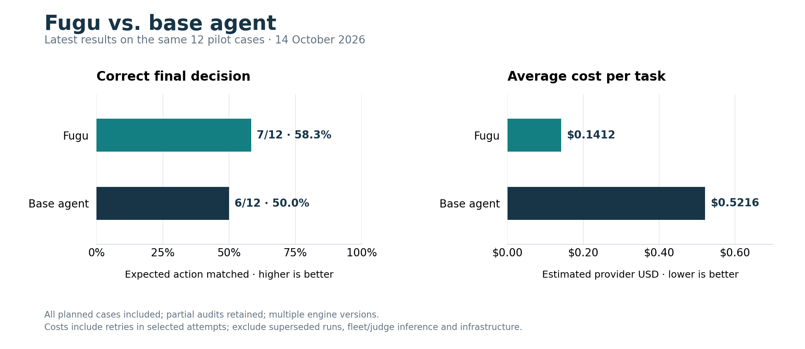
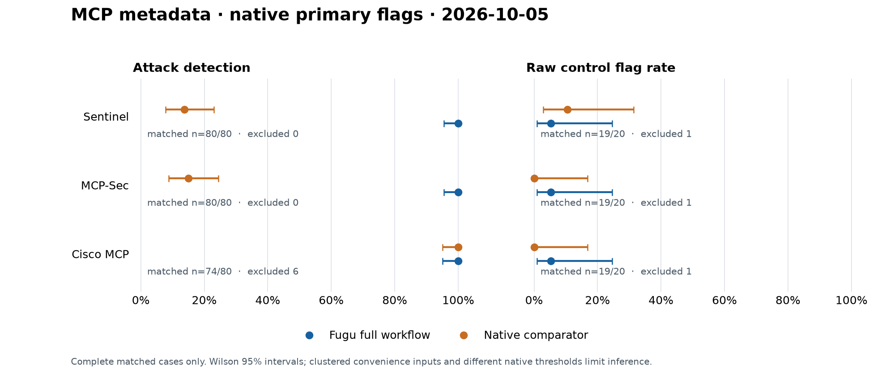
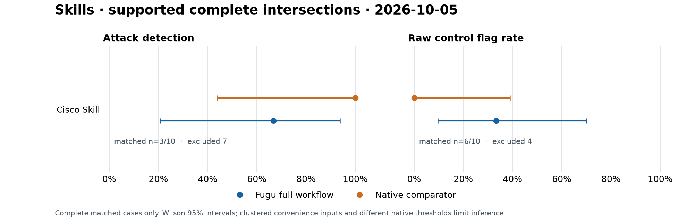
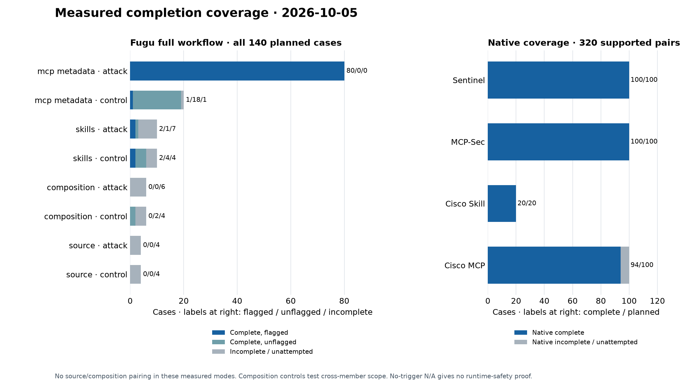

# 🐡 Fugu — audit before install

Fugu helps developers review community skills, MCP servers and plugins before
letting an AI agent use them with files, credentials and tools. Audit a candidate
extension, inspect the evidence and coverage, then decide whether to install,
investigate or ask for a fix. The result is a saved, inspectable audit.

Built for the [Nebius × NVIDIA Global AI Hackathon](https://nebiusglobalaihackathon.devpost.com/),
Coding and Agentic Engineering track. [MIT license](LICENSE).

**Judge reading path:** [Use case](#use-case) → [Checks and verdicts](#evidence-analysis-and-verdicts) →
[NVIDIA / Nebius](#nvidia-and-nebius-integration) → [Benchmark and charts](#full-workflow-benchmark-5-october-2026) →
[Maintainer outcomes](#real-world-outcomes-updated-12-october-2026) → [Run locally](#run-locally).
Try the [offline judge casebook](docs/judge-casebook.md) without credentials or paid inference.

## Use case

You find a community extension that could help your assistant, but want to
inspect what it asks the agent to do before granting access:

1. **Submit** one Git URL or directory on the API server; repositories may fan
   out into member audits.
2. **Read** the verdict, policy reasons and Analysis coverage. Expand findings
   for source exhibits and confidence: decoded instructions, concrete patterns,
   model judgments or observations from checks that actually ran.
3. **Act** on that evidence: investigate the source, request a fix, or make an
   install decision with the remaining coverage limits in view.
4. **Return** to the saved audit and its event history without submitting again.

The [authored offline casebook](docs/judge-casebook.md#inspect-the-evidence-and-decide)
shows the distinction: hidden Unicode instructions produce a local FAIL with a
decoded source exhibit; ordinary instructions produce a local-only PASS with
hosted checks skipped; absent input requires correction and retry, not a clean
verdict. These are crafted demonstrations, not a user study or population sample.

## Evidence, analysis and verdicts

| Check | Purpose | Evidence boundary |
|---|---|---|
| Concealment | Decode hidden Unicode instructions | Local, deterministic |
| Static | Identify concrete source patterns | Local, deterministic |
| Semantic | Read supplied text for injection and deceptive intent | Hosted Nemotron judgment, advisory |
| Detonation | Run derived triggers with fake canaries and collectors | Configured chamber runs triggers from `/opt/target`; observations cover executed triggers/collectors only |
| Harness | Compare baseline and extension-mounted responses | Hosted A/B stated-intent probes with deterministic signal checks; not a complete tool-execution loop |
| Reputation | Check package/domain context | Source-cited Tavily/OSV lookups |
| Composition | Analyze relationships in repository fan-out | Member findings and coverage; not proof every possible combination ran |

The table describes capabilities, not execution order. Deterministic source
findings and observed behavior are distinct from advisory model judgments.
The [verdict policy](src/fugu/verdict.py) returns **FAIL** for any critical finding
or deterministic/empirical high; **WARN** for other high/medium findings,
failed/partial analysis or omitted skill units; otherwise **PASS**.

**PASS covers only performed checks; it does not certify safety.** Intentional
skips can accompany PASS, so inspect coverage as well as severity. A target with
no runnable trigger was **not executed**. No canary hit in a bounded run does not
prove harmless behavior. Optional scanner configuration is in the
[developer reference](docs/readme-reference.md#optional-static-tool-surface-scanner).

## NVIDIA and Nebius integration

NVIDIA Nemotron supplies the semantic reading and extension-mounted A/B model
responses; Nebius Token Factory hosts that inference. The
[client](src/fugu/client.py) uses the OpenAI-wire-compatible SDK;
[configuration](src/fugu/config.py) defaults to the
[EU endpoint](https://api.tokenfactory.nebius.com/v1/) with `NEBIUS_BASE_URL` overrides.

| NVIDIA model | Current role |
|---|---|
| `nvidia/Nemotron-3-Ultra-550b-a55b` | Semantic judge; harness baseline, strong mounted arm and probe generation |
| `nvidia/nemotron-3-super-120b-a12b` | Harness everyday-agent mounted arm |
| `nvidia/NVIDIA-Nemotron-3-Nano-30B-A3B` | Available router tier; not established as an active pipeline stage |

The earlier dated benchmarks retain real hosted responses, model identities and
token usage, including the [2 October full-capability run](docs/benchmark-full.md).
Those runs did not measure dollar cost, remaining quota or monetary savings;
token counts alone do not establish those outcomes. The
[14 October cost pilot](#fugu-vs-base-agent-cost-pilot-14-october-2026) below reports
estimated provider cost for its selected attempts.

Concealment and static analysis run locally. **Enabled semantic and harness
stages send selected extension text and prompts to the configured inference
provider.** Reputation sends identifiers/queries to Tavily and pinned package
lookups to OSV; Git sources are fetched remotely. Docker is the default chamber.
The optional Contree/Nebius Sandboxes driver sends target files to remote compute
when selected; live remote sandbox behavior remains unverified. Review these
data flows before submitting confidential content.

## Fugu vs. base agent: cost pilot (14 October 2026)

On the latest twelve pilot cases, Fugu's final decision matched the frozen
expected action on **7/12 cases (58.3%)**, compared with **6/12 (50.0%)** for a
direct base agent. Estimated provider cost averaged **$0.141212 versus
$0.521577 per task**: **72.9% less for Fugu** on the selected latest attempts.

| Metric | Fugu | Base agent |
|---|---:|---:|
| Correct final decisions / all planned cases | 7/12 (58.3%) | 6/12 (50.0%) |
| Average estimated provider cost per task | $0.141212 | $0.521577 |



All 24 outputs have final answers, but six Fugu and eleven base-agent audits
remain partial. Exact action agreement is separate from the GPT-6.1-Sol judge's
broader diagnostic quality score: **5.58/10 for Fugu versus 5.71/10 for the base
agent**. This small sample does not establish higher general accuracy.

Costs include retries in the selected attempts and the base agent's required
finalization calls, but exclude superseded runs, fleet/judge inference and
infrastructure. The results combine several engine versions and one judge
with prior familiarity. See the [full report, per-test decisions and cost
accounting](docs/benchmark-cost-pilot-results-20261014.md) and
[reduced results data](bench/results/2026-10-14-cost-pilot/results.json).

## Full-workflow benchmark (5 October 2026)

On frozen workflow snapshot `dbc4f641`, Fugu completed **110/140 cases**; 30
remain partial. The four native scanner lanes completed **314/320 rows**; six
remain partial. The run recorded 4,581 SDK dispatches and 46 search calls, with
no provider errors or quota/budget stop.

The table compares primary flags on identical, completed attack inputs. The
native thresholds were fixed before measurement and differ by scanner.

| Native scanner / cohort | Complete attack pairs / planned | Fugu full-workflow flags | Native primary flags |
|---|---:|---:|---:|
| Sentinel / metadata (HIGH or CRITICAL) | 80/80 | 80/80 | 11/80 |
| MCP-Sec / metadata (risk ≥25) | 80/80 | 80/80 | 12/80 |
| Cisco MCP / metadata (native unsafe finding) | 74/80 | 74/74 | 74/74 |
| Cisco Skill / skills (HIGH or CRITICAL) | 3/10 | 2/3 | 3/3 |

MCP-Sec's secondary any-alert result is 66/80 attacks, distinct from its
12/80 primary result. Raw flags on completed clean controls were Fugu 1/19
metadata and 2/6 skills; Sentinel 2/19, MCP-Sec 0/19, Cisco MCP 0/19, and
Cisco Skill 0/6. These are unadjudicated, not population false-positive rates
(see the [full methodology and case-level results](docs/benchmark-full-workflow-20261005.md)).



*Metadata: 80 matched attacks for Sentinel and MCP-Sec, 74 for Cisco MCP, and
19 matched controls per comparison. Intervals are Wilson 95% intervals.*



*Fugu completed 3/10 planned skill attacks and 6/10 planned controls; the
matched complete intersection is n=3 attack pairs and n=6 control pairs. Cisco
Skill completed its full 20/20 lane. Intervals are Wilson 95% intervals.*



*Coverage: Fugu 110 complete and 30 partial; native lanes 314 complete and
6 partial. Twenty-eight Fugu cases were chamber-limited and two had harness
coverage shortfalls. All six partial Cisco MCP rows had analyzer coverage
failures; four retain raw alerts but are excluded from complete-case scoring.*

These are clustered, previously visible convenience fixtures, not a blind or
population sample. The skill comparison is small, thresholds are not calibrated,
and no overall superiority to Cisco or broad source/composition ranking follows.
In these measured modes, source and composition have no matching native
interface; composition controls use a cross-member contract rather than a
clean-package label. The [full methodology and case-level
results](docs/benchmark-full-workflow-20261005.md) include exclusions, native
thresholds, accounting and interpretation; the [sealed measurement inventory](bench/results/2026-10-05-full-workflow/measurement/inventory.json)
binds the retained artifacts.

## Real-world outcomes (updated 12 October 2026)

A **Fugu-assisted source review** identified missing HTTP timeouts in the
ComfyUI agent skill. The [maintainer confirmed the issue](https://github.com/MieMieeeee/comfyui-agent-skill/issues/3#issuecomment-6082877509)
and [fixed all seven HTTP calls in the 0.1.13 release commit](https://github.com/MieMieeeee/comfyui-agent-skill/commit/33b5b58b5be8f954f91f9df4508c8d3895a07af4),
with default connect/read timeouts of **10s / 60s**. This was identified by source
review during the Fugu-assisted investigation, not automated Fugu detection.

The same Fugu-assisted investigation reported a GOPROXY lookup failure in
**package-version-check-mcp**, identified by source review, not automated Fugu
detection. Maintainer **MShekow** [replied “Thanks for reporting!”](https://github.com/MShekow/package-version-check-mcp/issues/257#issuecomment-6095670010)
and merged [PR #262](https://github.com/MShekow/package-version-check-mcp/pull/262)
on **10 October 2026 at 08:26:40Z**; issue #257 was then closed as completed.
The merged PR confirms the fix: case encoding for uppercase Go module paths
while preserving canonical module names. It also documents the prior lookup failure.

Four public reports came from the investigation, with **two upstream fixes**.
Two reports remain open and unanswered as of **12 October 2026**; one is an
optional metadata improvement.

## Local CLI (bring your own key)

Install and configure the CLI using the [CLI guide](docs/cli.md). No Fugu account,
server or browser is required. Full mode sends selected text/prompts to Nebius
and bills your provider project; review the guide's data flows and exclusions.

```bash
fugu audit ./candidate --mode offline
fugu audit ./candidate --allow-hosted --format json > audit.json
```

Offline runs local concealment/static checks only. Inspect coverage with every
verdict; incomplete requested checks return exit 3 even with a PASS verdict.

## Run locally

Requirements: Python 3.10+, [uv](https://docs.astral.sh/uv/), and Node
20.19+ within the Node 20 series or Node 22.12+ for the current Vite build.
Docker is optional for execution checks; without a working chamber, inspect
coverage limits. Cloning currently requires repository access.

```sh
git clone https://github.com/Anton15K/fugu.git
cd fugu
uv sync --extra dev
cp .env.example .env
```

Set `NEBIUS_API_KEY` in your local environment/configuration for NVIDIA inference
on Nebius Token Factory. `TAVILY_API_KEY` is optional for reputation queries.
Keep both outside source control. Missing model credentials skip hosted analysis.

Build the browser UI and start the API with a dedicated development database:

```sh
cd web
npm ci
npm run build
cd ..
uv run --no-sync python -m fugu.server --port 8000 --db /tmp/fugu-dev.db
```

Open **http://127.0.0.1:8000/?mock=0** for live analysis. Select a **bundled example**
to fill the source, then choose **Start audit**, or enter a Git URL/server-local
directory. Bundled examples are crafted fixtures advertised when available.
Inspect verdict reasons, findings, confidence and coverage, plus the pipeline
and event history. Reopen `/audit/<id>` or choose **Continue an audit** to restore
persisted events with the same database without starting another audit.

Open **http://127.0.0.1:8000/?mock=1** and choose **Play simulated audit** for a
scripted walkthrough. Findings, timing and verdict are labeled simulated; no
extension is fetched or analyzed. This is not a recorded real audit or benchmark.
Live audit URLs reconnect to their actual server history.

For frontend development, run `npm run dev` from `web/`; Vite proxies `/api` to
port 8000. The `/tmp` database is disposable; use a persistent path for history
you need to retain. See the [web guide](web/README.md), or start with the
[offline judge casebook](docs/judge-casebook.md) for credential-free source checks.

**Access status:** source remains private; public judge access, hosted demo and
video remain unverified. These instructions do not establish submission readiness.

## Limits and further reading

Inference, source intake and execution coverage have limits. Consult the
technical reference before relying on a report beyond its performed checks:

- [Developer reference](docs/readme-reference.md): scanner configuration, current-source checks, bounded coverage and developer commands.
- [Production limits](docs/production-limits.md) and [source intake](docs/source-intake.md): request/file caps, coverage accounting and snapshot policy.
- [Dated assessment](docs/hackathon-assessment.md) and [human checklist](docs/human-hackathon-priorities.md): historical 7 October review; not reassessed here.
- [Under-three-minute demo script](docs/demo-script.md): proposed recording with explicit demonstration modes.
