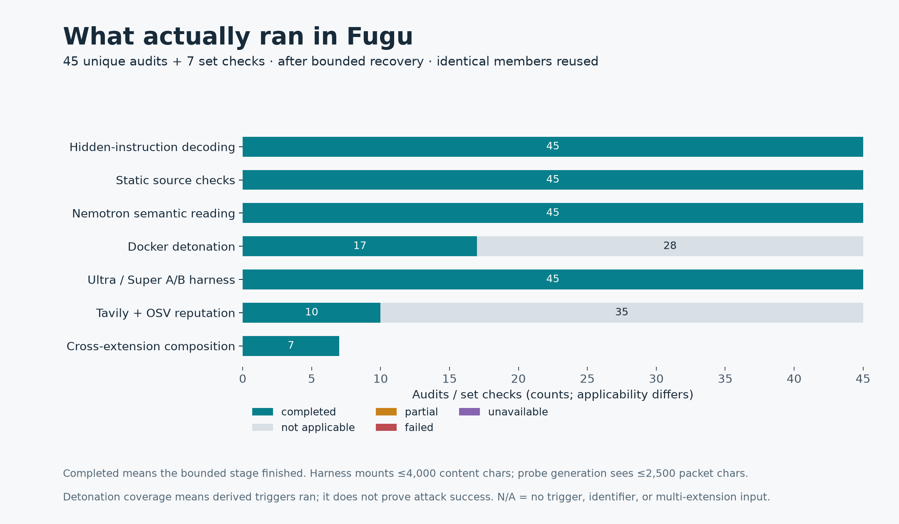

# 🐡 Fugu — audit before install

**Know what you’re letting in.** Fugu helps developers review community skills,
MCP servers and plugins before granting an AI agent access to files, credentials
and tools. Submit an extension, inspect the evidence behind its verdict, and
review the checks that completed before making an install decision.

A useful report points to decoded instructions, flagged source, or observed
behavior and distinguishes direct evidence from a model’s judgment. **PASS is
limited to the performed checks; it does not certify safety.**

Built for the [Nebius × NVIDIA Global AI Hackathon](https://nebiusglobalaihackathon.devpost.com/),
Coding and Agentic Engineering track. [MIT license](LICENSE).
A public hosted demo and public YouTube video have not been published. The
repository is currently private; public judging access remains a submission task.

## Run locally

Requirements: Python 3.10+, [uv](https://docs.astral.sh/uv/), and Node
20.19+ within the Node 20 series or Node 22.12+ for the current Vite build.
Docker is optional for execution checks; without a working chamber, review the
reported coverage limits. Cloning currently requires repository access.

```sh
git clone https://github.com/Anton15K/fugu.git
cd fugu
uv sync --extra dev
cp .env.example .env
```

Set `NEBIUS_API_KEY` in your local environment/configuration to enable NVIDIA
inference on Nebius Token Factory. `TAVILY_API_KEY` is optional for reputation
queries. Keep both outside source control. Missing model credentials skip hosted
analysis rather than producing evidence that it ran.

Build the browser UI, then start the API with a dedicated development database:

```sh
cd web
npm ci
npm run build
cd ..
uv run --no-sync python -m fugu.server --port 8000 --db /tmp/fugu-dev.db
```

Open **http://127.0.0.1:8000/?mock=0** for live analysis. For frontend development,
run `npm run dev` from `web/` while the API runs; Vite proxies `/api` to port 8000.
The `/tmp` database is disposable; choose a persistent path for history you need
to retain. See [web instructions](web/README.md).

1. Select a **bundled example** to fill the source, then choose **Start audit**.
   Examples are crafted fixtures advertised by the API when available.
   Alternatively enter one Git URL or one directory on the API server.
2. Inspect the returned verdict, policy reasons and **Analysis coverage**.
   Expand a finding to see its source/exhibits and confidence tier. The full
   pipeline and event history are available below the report.
3. Reopen the existing `/audit/<id>` URL or choose a run under **Continue an
   audit**. With the same database, persisted events restore that run without
   submitting another audit.

Open **http://127.0.0.1:8000/?mock=1** and choose **Play simulated audit** for a
scripted walkthrough. Its findings, timing and verdict are labeled simulated;
no extension is fetched or analyzed. It is not a recorded real audit or
benchmark evidence. Live audit URLs reconnect to their actual server history.

## Evidence, analysis and verdicts

| Check | Purpose | Evidence boundary |
|---|---|---|
| Concealment | Decode hidden Unicode instructions | Local, deterministic |
| Static | Identify concrete source patterns | Local, deterministic |
| Semantic | Read supplied text for injection and deceptive intent | Hosted Nemotron judgment, advisory |
| Detonation | Run derived triggers with fake canaries and collectors | Configured chamber; observations limited to executed triggers/collectors |
| Harness | Compare baseline and extension-mounted responses | Hosted A/B stated-intent probes with deterministic signal checks; not a complete tool-execution loop |
| Reputation | Check package/domain context | Source-cited Tavily/OSV lookups |
| Composition | Analyze relationships in repository fan-out | Member findings and coverage; not proof every possible combination ran |

The verdict policy returns FAIL for critical findings or deterministic/empirical
highs; WARN for other high/medium findings, failed or partial analysis, or omitted
skill units; otherwise PASS. Intentional skips can accompany PASS, so read
coverage alongside severity. A target with no runnable trigger was **not
executed**. No canary hit in a bounded run does not prove harmless behavior.

## Nebius and NVIDIA integration; data flow

The [client](src/fugu/client.py) uses the OpenAI-wire-compatible SDK against the
configured Nebius Token Factory endpoint. [Configuration](src/fugu/config.py)
defaults to its EU endpoint and supports `NEBIUS_BASE_URL` overrides.

| NVIDIA model | Current role |
|---|---|
| `nvidia/Nemotron-3-Ultra-550b-a55b` | Semantic judge; harness baseline, strong mounted arm and probe generation |
| `nvidia/nemotron-3-super-120b-a12b` | Harness everyday-agent mounted arm |
| `nvidia/NVIDIA-Nemotron-3-Nano-30B-A3B` | Available router tier; not established as an active pipeline stage |

Token Factory provides runtime inference for the security reading and A/B
comparisons through the same client interface. The full benchmark retains raw
responses, model names and token usage. Dollar cost, remaining quota and monetary
savings were not measured.

Concealment and static analysis run locally. **Enabled semantic and harness
stages send selected extension text and prompts to the configured inference
provider.** Reputation sends identifiers/queries to Tavily and pinned package
lookups to OSV; Git sources are fetched remotely. Docker is the default chamber.
The optional Contree/Nebius Sandboxes driver sends target files to remote
compute when selected; live sandbox behavior has not been verified here.
Fugu is not an entirely local analysis system. Review these flows before
submitting confidential content.

## Full-capability benchmark

**40 frozen cases, 40 completed after bounded response recovery**, measured on
2 October 2026. Every applicable capability ran: concealment, static, semantic,
Docker detonation, A/B harness, reputation and composition. Detection means a
medium-or-higher finding; composition scores its cross-extension rules separately.

Fugu and the local competitors received the same **15 MCPTox attack descriptions
and five constructed clean descriptions**. Source fixtures, composition and
dependency probes are separate cohorts rather than extra competitor misses.

| Tool / measured outcome | Attack descriptions flagged | Confirmed false positives |
|---|---:|---:|
| **Fugu — medium+ security finding** | **12/15 (80%)** | **0** |
| fuzzd 0.13.0 — medium+ finding | 10/15 (66.7%) | 0 |
| fuzzd — any finding | 11/15 (73.3%) | 0 |
| mcp-sec-audit 0.1.0 — capability hit | 12/15 (80%) | 0 |
| mcp-sec-audit — aggregate medium+ risk | 0/15 | 0 |
| Snyk Agent Scan 0.6.8 | Unavailable: hosted daily quota exhausted | Unscored |

Capability hits and aggregate risk are different tasks from malicious-instruction
detection. Severity labels also differ across tools. These fresh measurements
show how the pinned tools behaved on this sample; they do not establish a
universal ranking or population false-positive rate.


| Other Fugu cohorts | Measured result |
|---|---|
| Authored source attacks | 7/7 alerted |
| Authored composition attacks | 4/4 rule alerts |
| Authored composition controls | 0/3 rule alerts |
| Exact-version dependency probes | 2/2 alerted; both pins have OSV vulnerability records |

Authored fixtures are regression evidence, separate from external attacks.
The full case breakdown is retained in the report and raw results.



The 40 cases include shared composition members, producing 45 unique audits and
seven set checks. A completed stage means its bounded checks finished. The A/B
harness measures stated plans and replies, with up to 4,000 mounted content
characters; Docker observations depend on which triggers actually execute.

The initial run completed 15/40 cases. Seven malformed structured replies and
52 missing A/B replies recovered through bounded, identical-prompt retries.
Every valid original reply was preserved; no unresolved parsing exclusions
remain. Recovery improved this evaluation's completion without changing the
application's default output limits.

[Full protocol and results](docs/benchmark-full.md) ·
[Cohort chart](bench/results/2026-10-02-full/charts/cohort-results.svg) ·
[Stage contribution chart](bench/results/2026-10-02-full/charts/stage-alerts.svg) ·
[Recovery chart](bench/results/2026-10-02-full/charts/recovery-reliability.svg) ·
[Final raw results](bench/results/2026-10-02-full/fugu-recovered.json) ·
[Frozen cases](bench/results/2026-10-02-full/cases.json) ·
[Competitor versions and results](bench/results/2026-10-02-full/competitors/summary.json).

## Verification and limits

From the repository root: `uv run --no-sync python -m pytest -q`. From `web/`:
`npm run build`, `npm run lint`, `npm run contract`, `npm run smoke`,
`node scripts/audit-result.mjs`, and `node scripts/edge-reducer.mjs`.
The benchmark's scoped checks passed **37 tests** and independent review verified
the chart arithmetic, original evidence preservation and application hashes.
Verification history and the advisory judging score are in the
[assessment](docs/hackathon-assessment.md).

Source preflight rejects descendant symlinks before host reads and remote payload
construction. It is not race-proof isolation of a changing source tree. Execution
coverage depends on chamber availability and trigger derivation. The new
benchmark exercised the Docker chamber; remote Nebius Sandboxes transport remains
unverified. Public deployment safety is not
established by local tests or these guards. No deployment target is assigned.

[User story, advisory rubric and readiness](docs/hackathon-assessment.md) ·
[Under-three-minute demo script](docs/demo-script.md).
