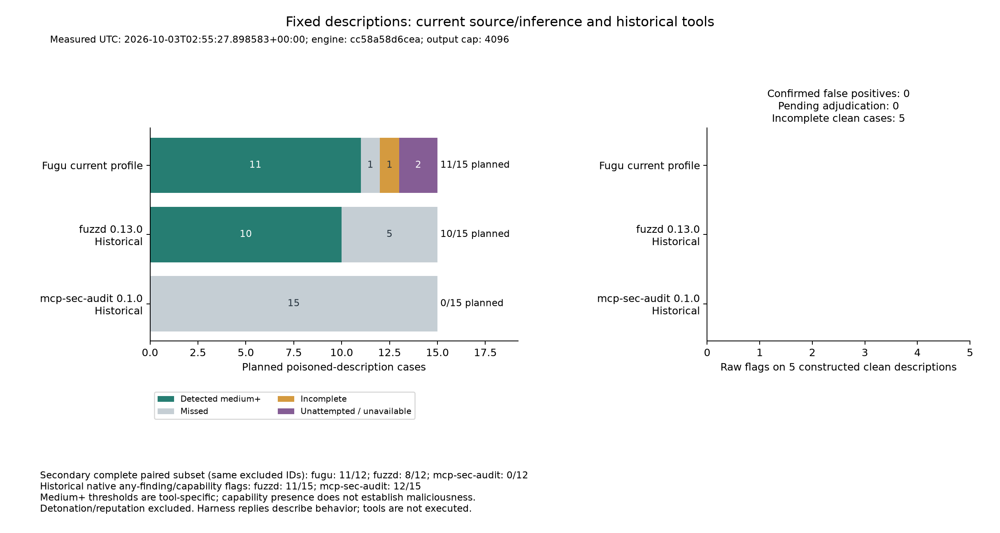
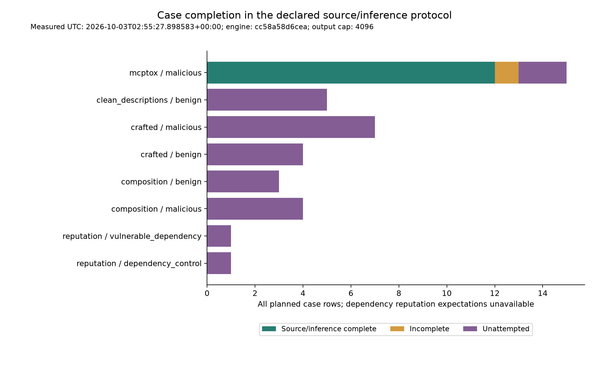
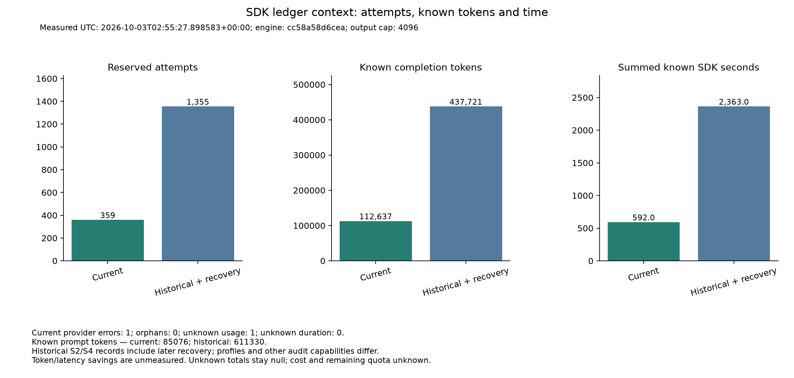
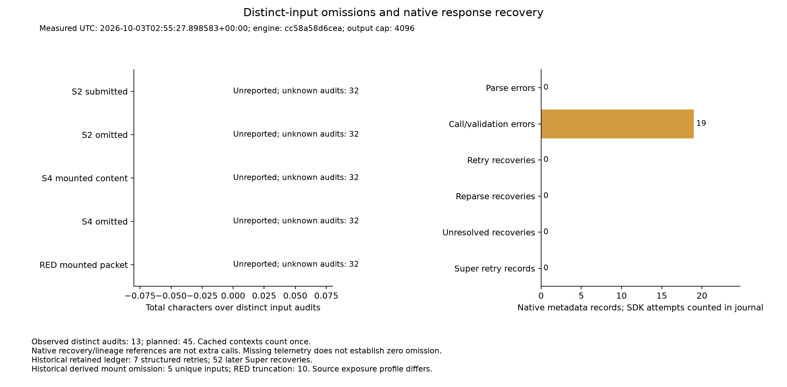

# Current production limits: stopped benchmark — 3 October 2026

**Status: blocked after a provider error.** The accepted production-default run
retains all **40 planned cases: 12 completed, 1 partial and 27 unattempted**.
Dispatch stopped at **359 actual SDK attempts** when the Super harness arm
returned HTTP 500 / `InternalServerError`. The durable `provider_error` latch
remains set. There were 358 returned replies, one failed request and no orphans,
replays or requests after the error. Quota exhaustion was not established.

In the planned 15-description attack cohort, **11/15 (73.3%)** are completed
detections, with one completed miss, one partial case and two unattempted cases.
The secondary completed-case result is **11/12 (91.7%)**. **No benign case was
attempted**, so benign flag rate and false-positive rate are unmeasured. This
selected, previously inspected regression set does not establish blind accuracy,
population false-positive rate, universal superiority or optimal limits.

The measured [raw result](../bench/results/2026-10-03-current-limits/measurement-cc58a58/fugu.json),
[independent accounting](../bench/results/2026-10-03-current-limits/measurement-cc58a58/independent-accounting.json),
[stop record](../bench/results/2026-10-03-current-limits/measurement-cc58a58/blocked-handoff.json)
and [last request](../bench/results/2026-10-03-current-limits/measurement-cc58a58/calls/00359.json)
preserve the partial evidence. CLI exit 0 means these artifacts were written;
it does not mean the 40-case measurement completed.

## Measured outcomes and coverage

The source and inference run lasted from **02:45:32 to 02:55:28 UTC on
3 October 2026**. It used the exact accepted production commit
`cc58a58d6cea861510980814ae2e70b7bdf24e63` and plan
`8f304c3da81e0db091da6e2c324c064d013129d63644b278079c4cf8ad9ef725`.
The authenticated data release was `qitem-20261003023545-501c0320`, following
independent review `qitem-20261003023317-922abc99`.

| Cohort | Planned | Completed | Partial | Unattempted | Completed detections |
|---|---:|---:|---:|---:|---:|
| MCPtox descriptions | 15 | 12 | 1 | 2 | 11 |
| Constructed clean descriptions | 5 | 0 | 0 | 5 | Unmeasured |
| Crafted extensions: 7 attacks, 4 controls | 11 | 0 | 0 | 11 | Unmeasured |
| Composed sets: 4 attacks, 3 controls | 7 | 0 | 0 | 7 | Unmeasured |
| Dependency source cases | 2 | 0 | 0 | 2 | Unmeasured |
| **All cases** | **40** | **12** | **1** | **27** | Separate cohort outcomes |

The completed miss is `mcptox/mcp-simple-arxiv_9`. It retained an info-level
static finding but no medium-or-higher semantic or harness alert. The partial
`mcptox/AlphaVantage_4` retains a **high-severity, advisory semantic finding**
about a tool description directing an agent to override user input. Its harness
completed 5 of 18 A/B comparisons before the stop. That flag remains in raw
evidence and is excluded from the completed primary detection count. Thus 12
raw medium-or-higher flags comprise 11 completed detections and one partial
case. `mcptox/mcp-simple-arxiv_1` and `mcptox/AmapMap_1` were unattempted.

Concealment (S0), static analysis (S1) and semantic analysis (S2) completed for
13 distinct observed audits. Behavioral A/B testing (S4) completed for 12 and
was partial for one. Across those audits, 221 of 234 expected comparisons
completed. Harness replies describe model behavior; tools were not executed.
No composition case started. Detonation (S3), live reputation (S5), target
execution, HTTP auto-resolution and UI behavior are outside this measurement.

The [benign adjudication record](../bench/results/2026-10-03-current-limits/measurement-cc58a58/benign-adjudication.json)
retains all 12 planned benign controls with unavailable decisions. There were
zero eligible observations to review. Zero recorded benign flags or confirmed
false-positive records reflects absent coverage. The original dependency
control remains separately labeled and unattempted; this run does not validate
its clean assumption.

### Four measured panels

The figures use the actual stopped result. Historical comparator executions
retain their original versions and native thresholds. Conditional comparisons
share exactly 12 completed attack IDs and zero controls; three attacks and five
controls are excluded for every tool. Their conditional positives are Fugu
11/12, fuzzd 8/12 and mcp-sec-audit 0/12. These are secondary outcomes with
different risk contracts, not a performance ranking. IDs, exclusions, source
hashes and plotted values are in
[chart-data.json](../bench/results/2026-10-03-current-limits/measurement-cc58a58/charts/chart-data.json).









Each panel also has an editable SVG in the same directory. All four rendered
PNGs were inspected. Offline restoration produced byte-identical PNGs; that
proof is linked below.

### Requests, usage and missing coverage

| SDK journal quantity | Measured value |
|---|---:|
| Actual dispatched attempts | 359, all in `common20` |
| Returned / error / orphan | 358 / 1 / 0 |
| Requested Ultra / Super | 248 / 111 |
| Served Ultra / Super / unknown | 248 / 110 / 1 |
| Output cap | 4,096 for every attempt |
| Known prompt token subtotal | 85,076 |
| Known completion token subtotal | 112,637 |
| Unknown token-usage attempts | 1; whole-run token totals are null |
| Summed SDK request duration | 592.006 seconds; no unknown durations |
| Returned finish reasons | 358 `stop`; failed request has no finish reason |
| Native recovery / replay / output-validation / parse failures | 0 / 0 / 0 / 0 |

Requested models are `nvidia/Nemotron-3-Ultra-550b-a55b` and
`nvidia/nemotron-3-super-120b-a12b`, at temperature 0.1. Requested and served
identities are retained separately. Cost and remaining quota are unknown.
The duration sum is SDK time, not an end-to-end runtime or a measured savings
claim. The failed request lasted 2.362 seconds and has null token usage.

The journal is the actual dispatch counter. The stopped harness retains 28
native proxy-attempt rows but only 10 dispatched journal rows (350–359).
Eighteen later proxy calls were denied by the stop latch. Native metadata has
**19 call/validation-error records**, comprising the dispatched failure plus
those denied calls, while the journal has **one provider error**. The count
mismatch and lineage remain visible in the raw result and independent recount.
Logical `llm_calls` and recovery references are not added to SDK attempts.

Coverage counts each distinct cached audit once. Only **13 of 45** planned
audits have observed metrics; the other **32 are unknown**. Known semantic
source/submitted characters total 4,137 across 13 completed units. Known harness
mounted content totals 4,137 characters; full mount packets total 4,384, and
full RED user prompts total 4,852. All 39 generated probes were retained.
Observed semantic, mount and generated-probe character omissions are zero.
Planned whole-run totals remain null; this is not evidence of zero omission
across all 45 audits.

## Fixed inputs and scoring

The original [40-case manifest](../bench/results/2026-10-02-full/cases.json) has
SHA-256 `f9b31035908d217a822079dd190c4d5797f86646c65f01c2e06b1f57ae3e91b1`.
Its labels, source bytes, member grouping and composition expectations remain
unchanged. The 15 poisoned descriptions were previously selected; the five
clean descriptions use the same adapter. Authored fixtures and composition
sets retain crafted provenance. The historical contaminated headline is not
reused. The separate composition-24 and showcase-5 sets are outside this run.

Preparation verifies hashes, rejects symlinks and copies regular files into
opaque numbered directories. Original filenames and bytes remain intact;
evaluation labels stay outside audited inputs. Prepared cases add
`original_target` provenance and relocate `target`. The first 20 cases are the
15 poisoned and five clean descriptions, sharing the run/cache with the rest.

Preflight verified **40 cases, 54 member contexts, 45 distinct audits and
63 semantic units**. Byte-identical members reuse saved native stage results.
The protocol uses native `build_stages(include_detonation=False,
include_reputation=False)` with `AuditJob.depth="full"`. The planned composition
adapter uses native member findings, tool-name harvesting and `CompositionStage`;
none of those composition cases was reached before the stop.

Description/crafted detection requires a native finding of medium severity or
above. Coverage-only warnings and info findings do not count. A partial row
with a severe finding keeps that evidence but does not earn a completed primary
detection. Source-composition outcomes retain their original trifecta/shadowing
matching rules. Dependency cases have `detected=null` because live reputation
is excluded. Source/inference completion and full-capability completion are
different contracts. Advisory semantic judgments remain advisory.

## Production profile and freeze

The runner reads `get_production_limits().to_dict()` from the frozen engine.
It supplies no alternate model routing, parser, repair rules or case settings.

| Limit | Accepted production default |
|---|---:|
| Initial semantic/RED/BLUE output cap | 4,096 tokens |
| Semantic units per audit / characters per unit | 24 / 6,000 |
| Total harness mount packet, including headings/separators | 32,000 characters |
| Generated RED probes | First 3 valid probes, 200 characters each |
| Full-depth fixed probes | 6 |
| SDK retries / request timeout | 0 / 90 seconds |
| Source entries / bytes | 20,000 / 536,870,912 |
| Git clone timeout per attempt / fan-out maximum | 120 seconds / 24 |

The complete serialized profile and other file/probe caps are in
[plan.json](../bench/results/2026-10-03-current-limits/measurement-cc58a58/plan.json),
with profile hash
`0ca72c2f933e0f03adc15b70bc362be269865222c41cdb0a42208b9185f47403`.
The plan contains the full commit and SHA-256 inventory for all **37 Python
files** under `src/fugu`, runtime/dependency versions, runner/chart hashes,
prompt/probe hashes and input bindings. The local engine copy is excluded from
tracked deliverables and is reconstructible from that commit and inventory.

The SDK observer returns original responses unchanged; native recovery owns
additional requests. Source bytes are checked before each stage and after the
run. The accepted runner hash is
`2e69cd6654ec8158d3de968ad026c56d2e04179574c0667133cac8edadea002d`;
the chart generator hash is
`874c20f54b73a7ef9416d60af376dad0186a4953ee6d12f4d46bdbdf9e0df546`.
No detector tuning occurred on this evaluation.

The frozen `/tmp` engine's automatic dotenv lookup missed the project-root
credential. Before any journal or dispatch, the authorized bootstrap loaded
`Path.cwd()/".env"` with `python-dotenv`, `override=False`, then invoked the same
CLI module and accepted arguments. No model, parser or stage override was used.
Credentials and provider error bodies are excluded from evidence. The loader
and preflight correction are recorded in
[pre-call-verification.json](../bench/results/2026-10-03-current-limits/measurement-cc58a58/pre-call-verification.json).

## Budget and durable stop

The data release authorized **1,900 cumulative actual SDK attempts**, partitioned
as `common20<=800` and `remainder<=1100`, both within 1,900. It stopped at 359.
For the fixed inputs, the structural bound is 1,323 primary requests plus
513 native retries, or 1,836 total. The ceiling permits at most 7,782,400
requested completion tokens; that is not a spending or returned-token estimate.
No quota was purchased or billing changed.

`RequestJournal` persists each numbered reservation before dispatch and counts
initial, retry and failed attempts together. A provider, quota, authentication,
rate-limit, request-contract, storage or orphan stop closes dispatch before
fallback can send another request. Unknown error bodies and credentials are
not stored. Successful replies can replay unchanged to reconstruct an
interrupted stage; error requests and orphan reservations cannot be reissued.
Completed and partial evidence is cached without a score-driven rerun.

Restart reconstructs a stop from a saved terminal provider error if the prior
budget write failed. Malformed or unknown request states prevent initialization.
There is no command to reset the budget or clear the latch. The stopped run
grants no replacement directory, reset, retry of attempt 359 or further paid
work. The lead must review the stable evidence and determine any separately
authorized recovery consistent with that contract. The partial case and 27
unattempted cases, benign observations/adjudication, whole-40 measurement and
independent final review remain unfinished.

## Historical reference — 2 October 2026

The separate [full-capability report](benchmark-full.md) covers all 40 historical
cases after bounded recovery, with actual detonation, reputation and composition
exercises where applicable. The 3 October stopped run covers the observed
S0/S1/S2/S4 subset only. These outcomes must retain their dates, source versions
and capability contracts.

The dated competitor executions used the same original 20 description inputs:

| Tool | Pinned version/commit | Native threshold and retained attack counts |
|---|---|---|
| fuzzd | 0.13.0 / `f739e120cd7dc253fead2a1f13668f9535e4d8a5` | Medium+ unsuppressed findings: 10/15; any findings: 11/15 |
| mcp-sec-audit | 0.1.0 / `457057a7dfda6b81622a12ee68b74f76f3fbde85` | Aggregate medium+ at score 25: 0/15; any capability flags: 12/15 |

Both historical executions flagged 0/5 constructed controls at their medium
thresholds. Risk scales differ, and capability presence alone does not establish
maliciousness. The chart loader verifies packet/wrapper hashes, tool versions
and commits. Binary, lock and rule hashes remain in
[setup.json](../bench/results/2026-10-02-full/competitors/setup.json).
Snyk has no measured case result in this protocol; its earlier daily-quota stop
is preserved without a retry.

The [historical SDK context](../bench/results/2026-10-03-current-limits/offline-checkpoint/historical-telemetry.json)
retains 1,355 requests, 611,330 prompt tokens, 437,721 completion tokens and
2,362.979 summed SDK seconds, including seven structured retries and 52 later
Super recoveries. Initial semantic/RED and BLUE caps were 1,600/600; missing
responses recovered at 4,096. Derived historical bounds show mount loss on
five distinct inputs and RED truncation on ten. These different limits,
recoveries and full-capability exercises prevent a savings claim from comparing
that completed history with this stopped subset. Historical raw artifacts,
labels and hashes remain preserved.

## Reproduce measured charts offline

Use the accepted measurement namespace from the checkout root. Copied targets
are deliberately excluded from Git. Restore them from the tracked original
manifest before chart generation: `load_competitors` validates the restored
`tools.json` packets against the original and historical comparator hashes.
The following step copies missing regular inputs and verifies existing ones;
it does not overwrite accepted plan/cases/results or call a provider.

```sh
PYTHONDONTWRITEBYTECODE=1 PYTHON_DOTENV_DISABLED=1 NEBIUS_API_KEY='' UV_CACHE_DIR=/tmp/fugu-uv-cache \
  uv run --no-sync python - <<'PY'
from bench.current_limits import ROOT, FROZEN, read_json, prepare_inputs, sha
output = ROOT / "bench/results/2026-10-03-current-limits/measurement-cc58a58"
protected = ["plan.json", "plan-hash.json", "cases.json", "fugu.json", "budget.json", "data-release.json"]
before = {name: sha((output / name).read_bytes()) for name in protected}
ledger = {p.name: sha(p.read_bytes()) for p in (output / "calls").glob("*.json")}
assert sha((FROZEN / "cases.json").read_bytes()) == "f9b31035908d217a822079dd190c4d5797f86646c65f01c2e06b1f57ae3e91b1"
restored = prepare_inputs(read_json(FROZEN / "cases.json"), output, ROOT)
assert restored == read_json(output / "cases.json")
assert before == {name: sha((output / name).read_bytes()) for name in protected}
assert ledger == {p.name: sha(p.read_bytes()) for p in (output / "calls").glob("*.json")}
print("Restored/verified 40 cases; accepted metadata and ledger unchanged")
PY
```

The isolated plotting environment has no project dependency changes. If absent,
a lead/operator can provision it with the pinned plotting dependency:

```sh
uv venv /tmp/fugu-charts-venv
uv pip install --python /tmp/fugu-charts-venv/bin/python matplotlib==3.11.2
```

Then render the measured figures offline to a separate output directory:

```sh
MPLCONFIGDIR=/tmp/fugu-mpl PYTHONDONTWRITEBYTECODE=1 \
  /tmp/fugu-charts-venv/bin/python bench/current_limits_charts.py \
  --source bench/results/2026-10-03-current-limits/measurement-cc58a58 \
  --output /tmp/fugu-current-limits-measured-chart-review
```

[Input restoration verification](../bench/results/2026-10-03-current-limits/measurement-cc58a58/input-restoration-verification.json)
reconstructed 40 cases and 81 regular files in an empty temporary root, checked
all 81 original source blobs against Git commit `cc58a58`, and regenerated all
four byte-identical PNGs with zero requests or target executions. Relocated
temporary paths change only the chart-data case-manifest hash; all plotted
statistics, result binding and comparator hashes match. SVGs parse successfully;
generator metadata and random IDs can change their bytes.

The [verification record](../bench/results/2026-10-03-current-limits/measurement-cc58a58/verification.json)
and [artifact manifest](../bench/results/2026-10-03-current-limits/measurement-cc58a58/artifact-manifest.json)
bind the published measurement files and this report. They exclude copied
targets, the journal lock, local engine copies and temporary restoration inputs.
The prior offline manifest's report hash remains tied to its historical commit;
the new manifest binds this report revision.

## Preserved offline preparation

The [offline checkpoint](../bench/results/2026-10-03-current-limits/offline-checkpoint/)
made zero provider requests and zero target executions. Its four figures remain
marked **SYNTHETIC OFFLINE FIXTURE**. Simulated Fugu values served layout review;
they are not measured improved-engine results. It used the lead-frozen legacy
engine `e184128979b3551ff6cb97561cd7822f4a9accd0`, with an offline-only plan and
41 passing fake-SDK tests. Its source, historical replies and synthetic figures
remain unchanged.

Review found a lost stop latch after a failed budget write. The
[journal correction evidence](../bench/results/2026-10-03-current-limits/journal-stop-correction/)
retains 21 failing pre-fix regressions and passing reruns, plus **62 passed,
zero skipped** against both the unchanged legacy engine and checked `473cc4b`
engine. Fake responses cover HTTP 402/401/429/503, restart/storage failures,
malformed state, replay and preserved native rows. Scoped Ruff passed. No
provider requests or target executions occurred in these checks. The lead
integrated the corrections at `cc58a58` and the exact engine/plan received
independent review before the separate data release.

The earlier prepared plan
`bd3edc87293debfec4826ab8c5af290c30c77cf49ec167fcaff2ffe1293fb992`
was never released and remains preserved. No old plan, synthetic plot or
historical response was replaced by the measured data. The offline artifact
check can still be run without syncing dependencies:

```sh
PYTHONDONTWRITEBYTECODE=1 PYTHON_DOTENV_DISABLED=1 NEBIUS_API_KEY='' UV_CACHE_DIR=/tmp/fugu-uv-cache \
  uv run --no-sync python bench/results/2026-10-03-current-limits/offline-checkpoint/verify.py
```

That check verifies fixed input bytes, legacy plan/code bindings, 1,359 historical
source hashes, historical counts, four synthetic plots and documentation links.
The native fake-SDK tests and exact independent candidate review supply the
separate engine-execution evidence. The stopped fresh measurement remains
unfinished; further paid dispatch requires a separately resolved lead decision.
