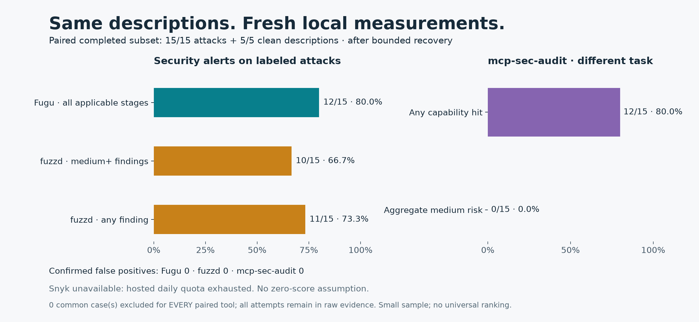
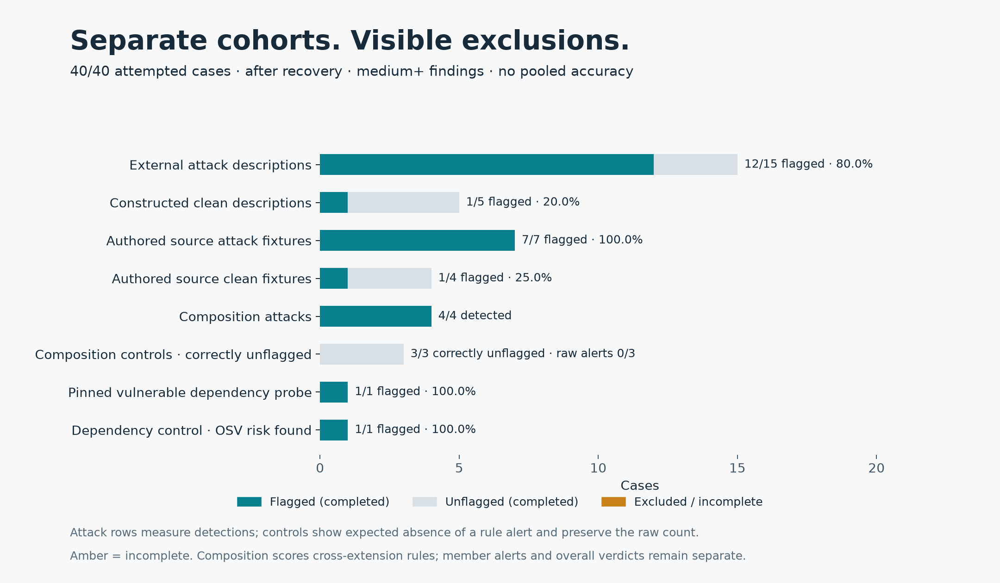
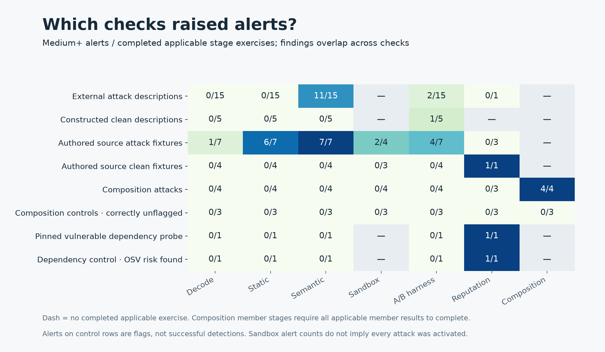
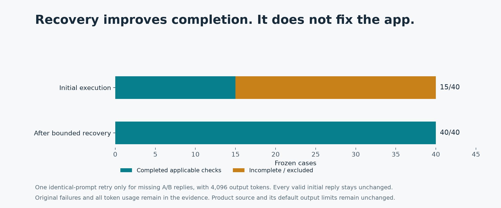

# Full-capability benchmark — 2 October 2026

Fugu attempted **40 frozen cases** and completed every applicable bounded check after recovery. Every pipeline capability had a real exercise: concealment decoding, static checks, semantic analysis, Docker detonation, behavioral A/B testing, reputation and composition. This evaluates those capabilities, not every backend variant or every possible behavior.

On the identical 20-description comparison, Fugu raised medium-or-higher alerts on **12/15 attacks (80%)**, versus fuzzd **10/15 (66.7%)**, with **0 confirmed false positives**. This small sample does not establish overall superiority. mcp-sec-audit identifies capabilities and aggregate risk, which are separate outcomes. Snyk could not be scored because its hosted daily quota was exhausted.

## New charts

All five charts are available as PNG and editable SVG in [the regenerated chart directory](../bench/results/2026-10-02-composition-v2/full-benchmark-charts/charts/). The data behind them is [chart-data.json](../bench/results/2026-10-02-composition-v2/full-benchmark-charts/charts/chart-data.json) and [cohort-data.csv](../bench/results/2026-10-02-composition-v2/full-benchmark-charts/charts/cohort-data.csv). The frozen original chart and raw result files remain unchanged.










## Frozen setup

Cases were selected before live inference, using SHA-256 ranking with seed `20261002-full`; no case was replaced after observing results.

| Cohort | Cases | Provenance and purpose |
|---|---:|---|
| Poisoned descriptions | 15 | External MCPTox: five per attack paradigm |
| Clean descriptions | 5 | Hash-selected constructed controls from fuzzd's clean corpus |
| Source fixtures | 11 | Existing authored regression fixtures: seven attacks, four clean-intent extensions |
| Composition sets | 7 | Four authored attack sets, three controls |
| Dependency probes | 2 | Exact requests pins: 2.19.1 and 2.32.5; the latter's clean assumption failed validation |

This is **20 description cases plus 20 source/set/dependency cases**, not 40 independent real-world attacks. Composition variants share members. Source fixtures and composition sets are authored regression evidence. Clean descriptions come from a comparator's constructed corpus. No combined “accuracy” score is reported.

The [frozen manifest](../bench/results/2026-10-02-full/cases.json) contains provenance, content hashes, membership, source hashes and application hashes. Targets were copied into opaque numeric directories. Evaluation labels, `case.json` and composition `set.json` metadata were excluded from detector inputs; authored source filenames and content remained intact. Identical member inputs were audited once and reused: **45 unique audits** support the 40 cases and seven composition checks.

For the shared cohort, Fugu and fuzzd received identical JSON packets with original tool names/descriptions and the required empty `inputSchema={}`. No parameter definitions, annotations or risk labels were invented. mcp-sec-audit's unmodified detector consumed the same original values through its required `tool_name` / `tool_content` wrapper. Packet hashes and adapters are recorded in [competitor setup](../bench/results/2026-10-02-full/competitors/setup.json).

## What “all capabilities” means here

The runner called the current product stages, rather than substitutes. Semantic analysis and the harness used Nebius Token Factory models `nvidia/Nemotron-3-Ultra-550b-a55b` and `nvidia/nemotron-3-super-120b-a12b`, temperature 0.1. The full-depth harness ran six fixed probes plus up to three generated probes, comparing baseline Ultra, mounted Ultra and mounted Super. Forty-two unique audits had nine probes; three had six because valid generator replies produced no extra probes (`crafted/05-obfuscated-payload`, `crafted/03-env-harvest-installer`, `mcptox/AmapMap_1`). These valid replies were retained without retry. Reputation used live Tavily and exact-version OSV queries. Composition used actual member findings and tool names. Product source hashes stayed unchanged throughout.

| Capability | Completed exercises after recovery | Not applicable |
|---|---:|---:|
| Concealment | 45 | 0 |
| Static | 45 | 0 |
| Semantic | 45 | 0 |
| A/B harness | 45 | 0 |
| Docker detonation | 17 | 28 |
| Reputation | 10 | 35 |
| Composition | 7 sets | Single-source audits |

Applicability matters: description-only inputs usually have nothing runnable; extensions without searchable identifiers do not require reputation; composition requires a set. These are explicitly recorded as N/A rather than errors or successful detections.

Completion means the **bounded stage finished**. Semantic analysis retains its eight-unit limit. The harness mounts at most 4,000 content characters, and generated probes see at most 2,500 packet characters. Nine of 54 case/member contexts exceed the mount content limit; [mount bounds](../bench/results/2026-10-02-full/harness-mount-bounds.json) document the omissions. The harness measures stated plans and replies, not an executing agent/tool loop. Docker was exercised; the alternative remote Contree backend was not.

Docker execution coverage does not guarantee every target activated. The installer-exfil fixture produced a canary hit and six HTTP flows. A supplementary diagnostic outside the 40 scored cases found a Python import trigger exiting with `ModuleNotFoundError`; a stage can finish collecting evidence despite that nonzero trigger exit. [Chamber diagnostics](../bench/results/2026-10-02-full/chamber-trigger-diagnostics.json) retain the observed distinction. No target content was executed on the host.

## Scoring and competitor results

Detection means at least one **medium, high or critical finding**. A coverage-only WARN does not count. Semantic judgments and empirical/deterministic findings retain their evidence tiers; an alert alone does not prove successful exploitation. Product verdicts are retained separately. Composition cohort scores refer specifically to composition rule flags, with member findings and overall verdicts available in the raw rows.

| Tool / outcome | Attacks flagged, same 15 inputs | Confirmed false positives, shared cohort |
|---|---:|---:|
| Fugu, any medium+ finding | 12/15 (80%) | 0 |
| fuzzd 0.13.0, medium+ finding | 10/15 (66.7%) | 0 |
| fuzzd, any finding | 11/15 (73.3%) | 0 |
| mcp-sec-audit 0.1.0, any capability hit | 12/15 (80%) | 0 |
| mcp-sec-audit, aggregate medium+ risk | 0/15 | 0 |
| Snyk Agent Scan 0.6.8 | Unavailable | Unavailable |

mcp-sec-audit's capability hits do not mean it classified those extensions as malicious. Its aggregate scores were below the medium threshold (25), with a maximum of 23.5. The comparison chart gives it a separate panel. Even Fugu/fuzzd severity definitions are tool-specific; equal words do not imply calibrated equal risk.

Pinned competitor commits: fuzzd `f739e120cd7dc253fead2a1f13668f9535e4d8a5`; mcp-sec-audit `457057a7dfda6b81622a12ee68b74f76f3fbde85`; Snyk `010712387e91fe7628cf356aeb83e78b6c6fc035`. Builds and runtimes were isolated from project dependencies. Snyk's pilot, outside the benchmark denominator, returned HTTP 429 with explicit daily-public-usage exhaustion; requests stopped. That is unavailable evidence, not a zero score. [Raw competitor results](../bench/results/2026-10-02-full/competitors/summary.json) record 20 supported description cases and 20 unsupported other cases for each local comparator. Unsupported cases are not misses.

All 20 shared cases completed after recovery, so the final comparison has **zero exclusions**. If an applicable stage had remained incomplete, that ID would be removed from every tool's paired comparison, while all attempts stayed in raw evidence. Competitor output parsing had no failures. Published promotional scores from other setups are not mixed into these fresh measurements.

## Fugu results and clean-input adjudication

| Cohort | Completed / attempted | Flagged |
|---|---:|---:|
| External poisoned descriptions | 15/15 | 12/15 |
| Constructed clean descriptions | 5/5 | 1/5 |
| Authored source attacks | 7/7 | 7/7 |
| Authored clean-intent source fixtures | 4/4 | 1/4 |
| Historical composition attacks, rule flags | 4/4 | 4/4 |
| Historical composition controls, correctly unflagged (raw rule alerts) | 3/3 (0/3) | 0/3 |
| Vulnerable dependency probe | 1/1 | 1/1 |
| Originally designated dependency control | 1/1 | 1/1 |

Missed external attacks: `mcp-simple-arxiv_9`, `Email_11`, `ClickHouse_14`. Semantic analysis alerted on 11/15 external attacks and the harness on 2/15, with overlap: their union is 12/15. Findings from stages cannot be summed as independent detections.

The clean-intent Node fixture received a medium reputation flag for lodash. This is dependency risk, not proof of malicious extension intent. A supplementary exact OSV check at its declared range floor, lodash 4.17.21, returned three advisory records; chalk 5.3.0 returned none. The declared range does not establish the installed version, and aliases can duplicate one vulnerability. [Adjudication evidence](../bench/results/2026-10-02-full/benign-reputation-adjudication.json) is separate from the frozen scores.

Both requests probes returned exact-version vulnerability records: ten for 2.19.1 and two for 2.32.5. The latter records alias the same insecure temporary-file vulnerability, [GHSA-gc5v-m9x4-r6x2 / CVE-2026-25645](https://osv.dev/vulnerability/GHSA-gc5v-m9x4-r6x2). **2.32.5 was not a valid clean dependency control.** The frozen designation remains visible; it is not used to estimate a dependency false-positive rate, and we neither relabel nor replace it to improve the score. This suite exercises reputation but does not establish its specificity against verified clean exact pins.

The historical composition outcomes above come from the frozen pre-clarification engine. Its four attack alerts include the `shadow-pair` set, which matched normalized tool names but had no evidence of a shared client namespace or resolution order. The three controls had zero rule alerts and were correctly unflagged. These raw results and labels remain unchanged; the revised chart makes the control interpretation explicit. Composition attack verdicts were WARN (medium rule findings), and all three control verdicts were PASS in that historical run. Those policy verdicts are distinct from benchmark rule detection.

The [new 24-case composition-v2 report](composition-coverage.md) uses the frozen engine for a baseline and the revised composition behavior for an after run. It covers eight source families, keeps 16 development and 8 author-known reserved cases, and reports misses, false positives and incomplete rows separately. The reserved split is not blinded. Its results do not relabel the historical 40-case benchmark.

## Parsing, recovery and reliability

The initial execution completed all applicable checks on only **15/40 cases**. Seven malformed structured replies recovered through one identical-request retry each (4,096 output tokens); none required trailing-comma repair. The conservative reparser allows only trailing commas outside strings; it does not invent missing fields or close truncated JSON.

Separately, **52 plain A/B replies were empty**, all from the Super arm at its 600-token allowance with `finish_reason=length`. Those made 29 unique harness audits partial and 25 cases incomplete. This is a real product-default reliability limitation.

The bounded recovery replayed every valid original response unchanged and retried only each missing arm once, with the identical model/system/user prompt and 4,096 output tokens. Exact model and ordered prompt hashes were verified before requests. All 52 retries returned nonempty replies, all 29 harness audits completed, and actual composition and verdict logic was recomputed from recovered members. No valid unflagged result was retried. Initial errors remain preserved in [fugu.json](../bench/results/2026-10-02-full/fugu.json), while [fugu-recovered.json](../bench/results/2026-10-02-full/fugu-recovered.json) contains final scores. Recovery improves benchmark completion; it does not change the application's default limits.

Final unresolved parse failures and incomplete exclusions: **zero**. [Recovery verification](../bench/results/2026-10-02-full/recovery/verification.json) confirms all 1,350 original evidence files and application hashes remained unchanged.

## Cost, evidence and reproduction

Execution ran from 08:59:34 to 09:42:54 UTC on 2 October 2026. Inference: **1,355 attempts**, including 52 recovery requests, under the 1,800-attempt bound. Total recorded usage: **611,330 prompt tokens and 437,721 completion tokens**. Tavily: 16 searches under the 180-search bound. SDK retries were disabled; requests had 90-second timeouts and exhaustion stops. No Fugu provider stop occurred. Monetary cost and remaining quota were not exposed by these clients and are recorded as unknown; an attempt bound is not a dollar cap.

Evidence includes frozen targets, original per-call responses and usage, original and recovered audit rows, source hashes, competitor stdout/results, chamber diagnostics and chart data. Synthetic canaries are test data. Credentials were supplied through existing configuration and were not included in targets or evidence. This chat lacked an authenticated OpenRig seat; the [local durable plan](superpowers/plans/2026-10-02-full-benchmark.md) records that limitation without impersonating a seat.

Offline checks and plot regeneration:

```sh
uv run --no-sync python -m pytest tests/test_full_capabilities.py tests/test_full_charts.py tests/test_recover_harness.py tests/test_benchmark_charts.py tests/test_harness.py -q
uv run --no-sync python -m bench.full_charts --bounds-only
# Use an environment containing matplotlib and numpy:
python -m bench.full_charts --recovered
```

The scoped check passed **37 tests**. All five final PNGs were visually inspected. Live runner scripts are `bench/full_capabilities.py` and `bench/recover_harness.py`; do not rerun them into this preserved evidence directory. A new live run requires a new output directory, refreshed provider availability and the same frozen selection if replication is intended.
