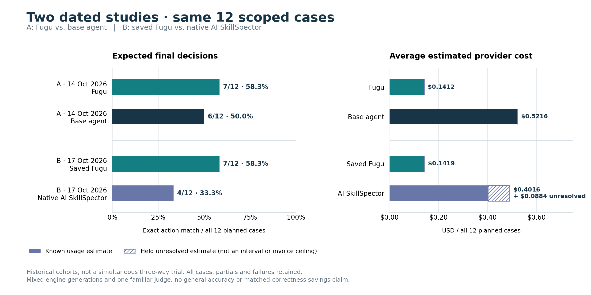

# Saved Fugu vs. native AI SkillSpector · 17 October 2026

Study B scores native AI SkillSpector against saved Fugu outputs on the same
12 frozen cases: eight security and four functional. Fugu matches the expected
final action on **7/12**, SkillSpector on **4/12**. Mean diagnostic quality is
**5.58/10** and **4.29/10**, respectively. This is a historical comparison, not a
fresh simultaneous trial of the current products. Study A's Fugu/base-agent
results remain separately dated [14 October](benchmark-cost-pilot-results-20261014.md).



## What was evaluated

The main requested model was `nvidia/Nemotron-3-Ultra-550b-a55b` on Nebius for
both approaches, with AI enabled. Architectures and model mixes differ: Fugu
includes Super critique, native OSV and runtime verification; native SkillSpector
uses offline OSV and has no Fugu-only sandbox or outer agent. Native SkillSpector
was pinned to **2.12.0**, upstream commit
`4c52fbb83bbca0dd13f2685453c9b661d8c95bf8`.

Eight saved Fugu outputs use older product versions; only three match the
exact current full engine. The c11 output uses current product/instrumentation
bytes but a distinct full engine generation. Per-case engine commits and
generation labels are preserved in the reduced data. Reusing saved outputs avoids new Fugu runs but
does not measure the latest product's causal effect. The new study date is
17 October 2026 local time; it does not relabel Study A's costs or generations.

The scoped frozen expected action is `accept` or `reject`. Exact final action
agreement uses **all 12 planned cases**, not only completed scans or emitted
reports; `investigate` is not an exact match. A correct action does not certify
the repository or establish that the nominated mechanism was found. Fugu's c08
is an example: its action matched, but the nominated GOPROXY bug was not found.
Both approaches missed that bug and the nominated missing HTTP-timeout bug.
Fugu also produced false alarms. Functional correctness is broader than
SkillSpector's primary security scope.

GPT-6.1-Sol (configured high) supplied one common panel with prior familiarity
and imperfect identity masking. The ten-point rubric gives decision 2,
issue/control 4, evidence/location 2, precision 1 and coverage/disclosure 1.
Quality is a qualitative rating, **not an accuracy probability**. Totals are
67/120 points for saved Fugu and 51.5/120 for SkillSpector. Neither the action
counts nor these scores establish general accuracy or equal correctness.

## Coverage and failures stay in the denominator

| Study B approach | Complete | Partial | Failed | Finals / planned |
|---|---:|---:|---:|---:|
| Saved Fugu | 6 | 6 | 0 | 12/12 |
| Native AI SkillSpector | 2 | 7 | 3 | 9/12 |

SkillSpector c08 hit wall time, c09 the harness arm cap, and c10 a timeout.
Their missing reports are retained failures, never clean results. Native AI
requests were real, but successful requests do not make a partial scan complete:
c11 reported `llm_available=false` despite 92 settled calls. The unchanged native
policy was 4,096 output tokens, 90-second SDK timeout, zero SDK retries,
660-second scanner timeout and $3 per arm. No new executions were made to produce
this documentation. Study A remains 6 complete / 6 partial Fugu and 1 complete /
11 partial base-agent workflows, with all 24 final answers present.

## Per-case primary results

Costs below are provider USD estimates for the selected primary attempts.
`—` means no final action. Points include partial coverage credit on failures;
they do not turn a failure into a completed audit. The unresolved amount is
separate from known usage. Full component points, workflow states, action-match
booleans and provenance hashes are in the [reduced data](../bench/results/2026-10-17-comparison/results.json).

| Case | Lane | Expected | Fugu action | AI SkillSpector action | Fugu points /10 | AI points /10 | Fugu known USD | AI known USD | AI unresolved USD |
|---|---|---|---|---|---:|---:|---:|---:|---:|
| c00 | security | accept | investigate | accept | 3 | 5.5 | 0.040397 | 0.035001 | 0.000000 |
| c01 | security | reject | reject | investigate | 10 | 9 | 0.044350 | 0.079620 | 0.000000 |
| c02 | security | reject | reject | reject | 9 | 8 | 0.066701 | 0.067456 | 0.000000 |
| c03 | security | accept | accept | investigate | 9 | 2.5 | 0.055959 | 0.061938 | 0.000000 |
| c04 | security | reject | reject | reject | 7 | 8 | 0.048035 | 0.080972 | 0.000000 |
| c05 | security | accept | accept | accept | 9 | 5.5 | 0.046842 | 0.050934 | 0.000000 |
| c06 | security | reject | reject | investigate | 9 | 6 | 0.078312 | 0.073700 | 0.000000 |
| c07 | security | accept | investigate | investigate | 3 | 2.5 | 0.065099 | 0.089385 | 0.000000 |
| c08 | functional | reject | reject | — | 3 | 0.5 | 0.356350 | 1.562587 | 0.000000 |
| c09 | functional | accept | reject | — | 2 | 0.5 | 0.299473 | 2.100559 | 0.000000 |
| c10 | functional | reject | investigate | — | 2 | 0.5 | 0.278982 | 0.011421 | 1.060864 |
| c11 | functional | accept | investigate | reject | 1 | 3 | 0.322150 | 0.606196 | 0.000000 |

## Cost accounting: selected attempts and separate historical views

All exact values use integer microdollars (1,000,000 = $1); displayed averages
are rounded. Every average divides by all twelve planned cases, including the
three failed native scans. These are usage/list-rate estimates, not invoices.

| Primary cohort / approach | Known microdollars | Held unresolved microdollars | Known USD / planned case | Held USD / planned case |
|---|---:|---:|---:|---:|
| A · Fugu | 1,694,544 | 0 | $0.141212 | $0 |
| A · Base agent | 6,258,924 | 0 | $0.521577 | $0 |
| B · Saved Fugu | 1,702,650 | 0 | $0.1418875 | $0 |
| B · Native AI SkillSpector | 4,819,769 | 1,060,864 | $0.4016474167 | $0.0884053333 |

The chart's solid bar is the known usage estimate. Its hatched extension is the
**held unresolved estimate**, not a confidence interval, guaranteed invoice bound
or settled usage. Do not silently drop or fold the held $1.060864 into known
cost. Selected-attempt costs include their internal retries. Study A also
includes required base-agent report-finalization calls. Neither study prices
native Codex judging/fleet inference, setup, CPU, Docker, human work or repairs.

Separate accounting views supplied with the sanitized summary:

- The failed native retry adds **548,477 known microdollars** outside the primary
  native selection: all native attempts are **5,368,246 known + 1,060,864 held**.
- All Fugu history is **3,775,843 known microdollars**; selected saved Fugu is
  **1,702,650**. These are overlapping views: **never sum them**.
- The separately sealed whole comparison program is **6,743,071 known +
  1,060,864 held** (7,803,935 including the held estimate). Reused selections and
  historical accounting views overlap; do not derive this by summing the rows
  of different views.
- Prior direct-agent experiment history is **15,923,729 microdollars**; the
  supplied broader historical liability view is **23,727,664**, including held
  estimates. It is not the chart's primary comparison cost.

Study A's original 72.9% selected-cost difference is confined to its historical
Fugu/base-agent pair. It is not a SkillSpector savings claim. Equal correctness
was not established; there is no matched-accuracy cost-saving claim.

## Public data, provenance and offline reproduction

The [reduced two-study JSON](../bench/results/2026-10-17-comparison/results.json)
embeds Study A's unchanged published data and the sanitized Study B summary.
Study B includes all 24 case rows, component scores, source-manifest hashes,
Fugu engine/generation identities, main model and SHA-only comparison, accounting
and judge seals. No local evidence paths, raw prompts, model responses or keys
are published. The owner-sanitized `public-summary-v2.json` input SHA256 is
`fbc42d11aae935b7189d8afe8654b2fb47e199fa6c22e3baa616a36b18d4f536`.
Source hashes identify the frozen scope; they do not imply complete coverage.
The public qualitative scores do not supersede strict adjudication status.

The new [renderer](../bench/results/2026-10-17-comparison/render_chart.py) uses
report-only **Matplotlib 3.10.8**, not an application dependency. With that package
already available in an isolated plotting interpreter, run from the repository
root (no installs, providers or target execution):

```sh
python bench/results/2026-10-17-comparison/render_chart.py --check
MPLCONFIGDIR=/tmp/fugu-chart-cache python bench/results/2026-10-17-comparison/render_chart.py
```

The first command recomputes decisions, costs and workflow counts from all cases,
and Study B quality totals/component means from its scored rows. Study A exposes
published quality aggregates only (67 and 68.5 points), not per-case scores;
those aggregates are retained, not reconstructed. The second command writes the
PNG and [SVG](../bench/results/2026-10-17-comparison/decision-cost-comparison.svg)
from adjacent data. Bars start at zero, action matches use a 0–100% axis, and cost
uses a separate USD-per-planned-case axis. Study A's original report, data,
renderer and images remain unchanged in their dated locations.
