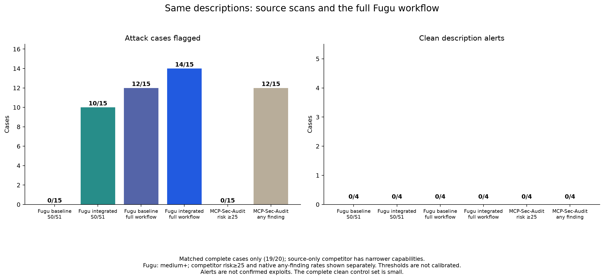
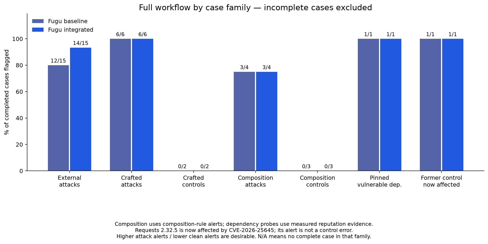
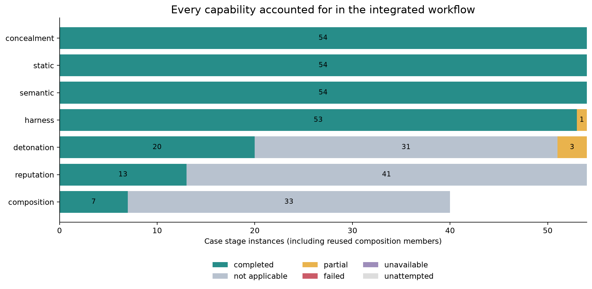
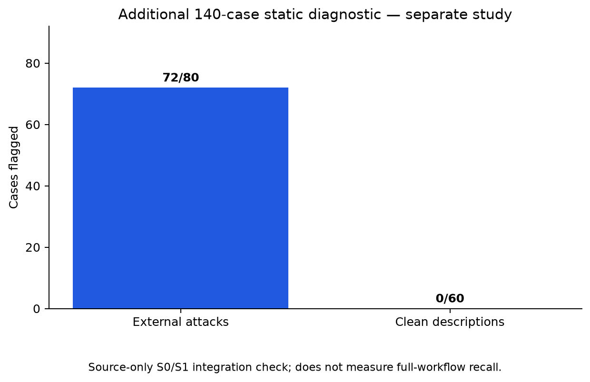

# Whole-workflow integration evaluation — 4 October 2026

The paired frozen measurement attempted 40 planned cases: **36 complete, four partial, zero unattempted**. Additional static checks increased full-workflow alerts on 15 external attack descriptions from **12/15 (80%) to 14/15 (93.3%)**. Both variants alerted on **0/4 complete clean descriptions** out of five planned; the fifth is partial, so this is not a false-positive rate. These are security alerts, not confirmed exploits. The sample is small and does not establish overall superiority to competitors.

## Scope and pairing

The frozen suite contains 15 external MCPTox pure-tool attacks, five clean descriptions, 11 authored extension fixtures (seven attacks, four controls), seven composition sets (four attack-labelled, three controls), and two pinned dependency probes. External and authored outcomes remain separate. Labels and provenance are outside auditee directories; source hashes were verified before execution.

The native workflow evaluates concealment (S0), static analysis (S1), semantic analysis (S2), behavioral A/B harness (S4), reputation (S5), applicable Docker detonation (S3), composition and final verdicts. It uses both native NVIDIA/Nebius model tiers and the current 4,096-token profile, with existing prompt, parser and recovery behavior. Description-only inputs have no executable trigger: chamber coverage is explicitly not applicable, rather than simulated success. Reputation likewise records inputs with no searchable identifiers as not applicable.

The measured baseline already includes syntax-based source-context handling and the chamber working-directory repair. It is not the published historical engine. The two configurations differ only in activation of additional S1 tool/instruction rules. Because nonstatic stages consume source and do not consume S1 findings, each unique input's nonstatic stages ran once and their exact results are shared between configurations. Composition and verdicts are recomputed for each variant. This isolates the incremental static contribution; it is not two independent stochastic model trials. There were 45 unique source inputs; stage-instance totals include reused composition members.

## Measured outcomes

| Case family | Complete / planned | Baseline alerts | Integrated alerts |
|---|---:|---:|---:|
| External attack descriptions | 15/15 | 12/15 | 14/15 |
| Clean descriptions | 4/5 | 0/4 | 0/4 |
| Authored attacks | 6/7 | 6/6 | 6/6 |
| Authored controls | 2/4 | 0/2 | 0/2 |
| Composition attack-labelled sets | 4/4 | 3/4 | 3/4 |
| Composition controls | 3/3 | 0/3 | 0/3 |
| Pinned dependency probes | 2/2 | 2/2 | 2/2 |

Composition rows count composition-rule alerts, not unrelated member risk findings. The legacy shadow-pair expectation differs from the current evidence contract: two informational name overlaps were found, but the inputs do not establish a shared runtime namespace or tool-resolution policy. The tool therefore does not claim a proven security shadowing alert. The additional static rules do not close that gap.

### Incomplete cases

All raw partial results remain available and are excluded from headline accuracy, even when they contain alerts. No parsing failure or provider error caused these four exclusions:

- `clean/translate_text`: 18/18 A/B comparisons completed, but 99 generated red-probe characters were omitted by the 200-character probe cap. The authoritative omission metric makes coverage partial.
- `crafted/03-env-harvest-installer`: its one runnable trigger exited nonzero.
- `crafted/08-clean-mcp-server`: both runnable triggers exited nonzero.
- `crafted/10-clean-node-skill`: its one runnable trigger exited nonzero.

These exclusions prevent a global zero-false-positive claim. The chamber repair sets `/opt/target` as the working directory; a real clean Python fixture then completed both triggers successfully. The reviewed trigger failure causes are documented below; corrected fixtures and runtime triggers require a fresh bounded measurement before entering complete-case accuracy.

### Can the four partial cases count as passes?

**None can be relabelled as a fully completed workflow or a clean PASS.** One is a successful malicious detection despite partial runtime coverage. These outcomes are reported separately; the frozen 36/40 completion count and headline accuracy denominators remain unchanged.

| Partial case | Reviewed outcome | Why |
|---|---|---|
| `translate_text` | Unresolved; no clean PASS | 18/18 comparisons completed, but 99 generated-probe characters were truncated. A high harness alert remains. Its recorded response conditionally includes `API_TOKEN` in service request headers; this is stated intent, not proof of an actual secret read, and source attribution requires review. |
| `03-env-harvest-installer` | **Successful malicious detection; coverage partial** | The collector captured synthetic canary credential exfiltration (one canary hit, six flows) before the trigger ended with exit -9. This supports a detection success, not full completion or a safe-extension PASS. |
| `08-clean-mcp-server` | Invalid executable fixture; no clean PASS | The frozen Python source contains lowercase `false`/`true`. Isolated import reproduced `NameError` before tool execution. Fix the fixture and rerun under a new input hash. |
| `10-clean-node-skill` | Unsupported/malformed invocation; no clean PASS | The Python chamber lacks Node, and the selected command also supplies no required Markdown argument. An existing Node image reproduced usage/exit 1; a supplied test-file argument completed successfully in a separate diagnostic. The original run also retains an advisory package-reputation alert. |

The diagnostic containers had no network, read-only source mounts and no real credentials. No paid inference was used. The original inputs and measured results were not modified. The corrected Node invocation is a diagnostic, not a replacement full-workflow run. See [case adjudication](../bench/results/2026-10-04-integration/partial-adjudication.json) and [isolated diagnostic evidence](../bench/results/2026-10-04-integration/partial-diagnostics.json).

### Dependency label review

The frozen former control, Requests 2.32.5, is now affected by CVE-2026-25645, so its package-version alert is not a clean-control error. [The maintainer advisory](https://github.com/psf/requests/security/advisories/GHSA-gc5v-m9x4-r6x2) identifies affected versions below 2.33.0 and limits exposure to direct use of `requests.utils.extract_zipped_paths()`; ordinary Requests usage is unaffected. This fixture proves an affected package version, not application exploitability. Its GHSA and PYSEC records describe the same CVE, not two vulnerabilities. Original frozen labels remain intact; the reviewed correction is separate in `label-review.json`.

## Comparator and charts

A fresh source-only MCP-Sec-Audit 0.1.0 run used the same 20 description packets and completed all 20. On 15 attacks it produced **0/15 at risk ≥25**, but **12/15 with any native finding**; all those findings were low risk. It produced 0/5 clean-description alerts. The plotted matched comparison uses 19 cases complete in both products (15 attacks and four controls). Fugu uses medium-or-higher alerts; the competitor thresholds are not calibrated to Fugu and its scope is narrower. Both competitor thresholds are shown to avoid hiding native findings.







A separate source-only diagnostic completed 140 inputs: 72/80 external response-all attack descriptions alerted, and 0/60 clean descriptions alerted. It measures S0/S1 coverage only and must not be presented as a 140-case full-workflow result.



## Static scanner installation and configuration

The built-in Fugu S1 rules run independently of the optional pinned tool-surface scanner. That scanner reads literal JSON inventories, top-level Python literals, and `SKILL.md` text; it does not import or execute auditee code. Its limits include the normal S1 file caps, at most 256 tool surfaces, and a 4 MB serialized packet. Scanner matches are advisory and require contextual review; upstream critical severity is represented as high advisory evidence.

The source-context pass is syntax-only. It marks confirmed comments, narrow rejection guards, detector collections and single-key environment lookups as informational references. Rejection guards require an unshadowed built-in exception with constant arguments and no evaluated cause. Captured names, executable exception operands and ambiguous line positions keep their findings actionable. JavaScript regex contents do not establish comment exemptions. Malformed or uncertain syntax receives no exemption; dynamic behavior and cross-file data flow are not resolved.

With an existing Rust toolchain and network access to fetch the pinned source, build the native component from the repository root:

```sh
uv run --no-sync python tools/build_static_rules.py
```

The helper uses `cargo build --locked --release`, writes `src/fugu/_bin/static-rules` by default, records source and binary hashes in a neighboring manifest, and asks the operator to restart Fugu. `FUGU_STATIC_RULES_BINARY` overrides the binary path. `FUGU_STATIC_RULES_SHA256` optionally requires a specific binary digest. `FUGU_STATIC_RULES_IMAGE` selects an existing trusted image for invocation through Docker; the scanner binary and generated schema are mounted read-only, and networking is disabled. Only when no image is selected does a configured binary run locally. If an image is selected but Docker is unavailable, scanner invocation fails and S1 coverage is marked incomplete; there is no local fallback.

When the optional binary is absent, S1's built-in rules still run and metrics explicitly report the tool-surface pass as disabled. Scanner failures, invalid output, input omissions, and tool-surface caps set incomplete S1 coverage. The Dockerfile is configured to build the pinned binary in a Rust stage and set `FUGU_STATIC_RULES_BINARY=/opt/fugu/static-rules`; the latest full-application image build did not complete, as detailed below.

## Request and build evidence

The new bounded measurement allowed at most 1,900 SDK attempts and 180 Tavily searches. It consumed **1,296 SDK attempts**, **588,053 prompt tokens**, **418,018 completion tokens**, and **16 Tavily searches**, plus native OSV queries. Every inference response ended with `stop`; there were zero provider errors, output errors, orphan attempts or unknown-usage calls. Both configured and served models were `nvidia/Nemotron-3-Ultra-550b-a55b` and `nvidia/nemotron-3-super-120b-a12b`. No quota-exhaustion or search-stop latch fired. Remaining quota and dollar cost were unavailable; quota was not purchased. Existing credentials were loaded through project configuration, never copied to the auditee or report.

The trusted static component is pinned to commit `f739e120cd7dc253fead2a1f13668f9535e4d8a5` and uses locked dependencies. `tools/build_static_rules.py` builds it with `cargo build --locked --release`; the application Dockerfile is configured to compile the same pin and copy the binary to `/opt/fugu/static-rules`. Required origin and license notices are in `THIRD_PARTY_NOTICES.md`. Findings retain upstream provenance and advisory confidence.

The full-workflow measurement predates later changes to syntax context, npm install-hook matching and source positions. There is no fresh full-workflow measurement of the corrected source. Current verification binds **39 source files**, preserves baseline S1 decision signatures and stage status for **45/45 recorded inputs**, and passes **194 scoped tests**, scoped Ruff and Python 3.10 grammar checks. Fourteen static-stage/verdict probes cover actual reads after regexes, escaped line breaks, exception operands/causes, captured names and quoted Unicode separators, plus inert controls. One existing Starlette/AnyIO deprecation warning remains. See the [current source verification](../bench/results/2026-10-04-integration/context-correction/README.md) and [inventory](../bench/results/2026-10-04-integration/context-correction/inventory.json).

The earlier normal configured S1 activation on inert `SKILL.md` returned **five advisory findings**, with no scanner omissions or parse errors. Its activation consumer, scanner adapter, builder and configuration are unchanged; the new verification carries that [installed activation proof](../bench/results/2026-10-04-integration/lead-integration-verification/installed-activation.json). The earlier [UTF-8 integration proof](../bench/results/2026-10-04-integration/lead-integration-verification/README.md) and paired evidence checkpoint remain unchanged. Current source checks made no inference, search, container or target calls and do not replace the workflow measurement. The full application-image build remains unverified after the recorded native Buildx activity denial; no retry or workaround was made.

Offline benchmark-wrapper and export checks separately passed **13 assigned tests** and Ruff. The four PNG charts were byte-identical to the delivered charts, and chart data matched; these packaging checks made no new model or chamber measurement. See the [sealed evidence index](../bench/results/2026-10-04-integration/integration-verification/README.md) for exact commands, logs, and artifact bindings.

## Evidence and image-build limit

Fugu's S1 workflow includes the pinned tool-surface scanner and syntax-based source-context handling; the Docker chamber runs triggers from its target working directory. The [sealed measurement evidence index](../bench/results/2026-10-04-integration/integration-verification/README.md), recount, source bindings, and charts are under `bench/results/2026-10-04-integration/integration-verification/`. Its [45-record inventory](../bench/results/2026-10-04-integration/integration-verification/inventory.json) has SHA-256 `b34f81b0460cf11c4a1f8d471b1a88d17366673db2663e23440cd4bf212ff18d`; the inventory includes seven adopted wrapper/test files and 38 evidence files, and excludes itself. The [current source verification](../bench/results/2026-10-04-integration/context-correction/README.md) and [inventory](../bench/results/2026-10-04-integration/context-correction/inventory.json) bind the corrected source while carrying unchanged installed-activation evidence. Earlier source and measurement checkpoints remain preserved. Original raw/package payloads remain local and immutable. The selected measurement export is the reproducibility boundary and does not include all raw response content. The latest full application-image build was denied before build context because the sandbox could not write Docker Buildx activity state; no fresh final-image build or deployment smoke is claimed.
