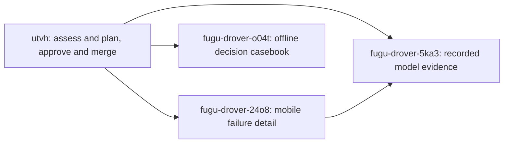

# Fugu hackathon improvement implementation plan

> **For agentic workers:** execute only your assigned ready bean through the existing fleet task-branch, independent named review and third-agent PR/CI workflow. Use native task-by-task execution; do not spawn new workers or watchers. The parent is planning only.

**Goal:** make current failure recovery immediately useful, expose recorded model evidence honestly and give judges reproducible offline decision examples.

**Architecture:** retain existing pipeline, server/event contracts and dependencies. The UI consumes already-returned data; the casebook exercises production local stages using temporary state. No benchmark reroll, paid model call or infrastructure change is part of these children.

**Tech stack:** existing Python 3.10+ / FastAPI / pytest and React / TypeScript / Vite / current node scripts. No dependency changes.

**Spec:** [current assessment and complete missing-point ledger](hackathon-assessment.md), parent `fugu-drover-utvh`. Baseline `2d117c1dc8c6358e856c5990a748f33ca628eb16`, **2026-10-07**. Advisory scores are T=7.50, D=7.50, I=6.00, Q=8.00; mean 7.25 → 7.3. Tasks are hypotheses for closing specific gaps, never score guarantees.

## Global constraints and existing work

PRs 17 and 18 are integrated. Do not recreate stopped-stream/retained-log fixes or snapshot cleanup. Current intake already discloses hosted text/data flow; README already documents source/model roles and benchmark limits. The current full suite is 980 passed, five existing chart skips, 23 subtests passed: the old 12 failures are not a new task.

Coder `fugu-codex-coder`, independent reviewer `fugu-codex-reviewer`, integrator `fugu-codex-integrator`. Work only on each assigned isolated child branch, merge current **local main** first, claim exact permitted paths and keep the child record/checklist current. No coder/reviewer push or landing. The integrator alone uses the already-authorized independent-review → task PR → all local/CI gates → merge loop; rejected work returns to the fleet.

Preserve Python 3.10 compatibility. Use `PYTHONPATH="$PWD/src:$PWD" PYTHON_DOTENV_DISABLED=1 NEBIUS_API_KEY="" uv run --no-sync` for offline Python. No dependency/environment sync, owner environment/database/log/credential access, historical artifact edits or OpenRig/runtime setup. Native permission/trust controls remain human-owned. No shared API/dependency/schema/infrastructure changes, paid evaluation, deployment, visibility/public-site change, submission or external outreach. An out-of-scope need becomes a clearly human-blocked proposal.

Only an agent-owned temporary fixture/static preview on an unused ephemeral loopback port (or a file fixture), with fake/offline providers and temporary state, is authorized for UI inspection. Label it, close it and the owned browser afterward. No shared dev server or original database. Copy no original `.env`, logs, credentials or uncommitted human work. All child records contain these constraints independently.

## Review focus

1. Extraction failure, unknown terminal reason and long/HTML-looking error: actual reason or explicit unknown stays visible, safe and recoverable. Mobile child owns real-render/reducer/viewport checks.
2. Missing/legacy/partial model metrics and null usage: no invented zero, served model, provider, dollar cost or complete coverage. Model child owns literal mapper/render cases.
3. Fan-out parent-only metrics and simulated metrics: supplied scope remains explicit; neither becomes complete member accounting or runtime proof. Model child owns these cases.
4. Ordinary source with hosted checks unavailable: a limited PASS never certifies safety; absent source never becomes a verdict. Casebook child owns real-source/API tests.
5. Fixture versus live sponsor/runtime claims: every screenshot/case names its boundary; no undocumented real-user outcome or benchmark claim. All child reports are reviewed for this; the casebook has blank human study outcomes.

## Ranked tasks and dependency graph

| Rank / actual ID | Priority / estimated effort | Missing-point mapping and gain hypothesis | Regression risk / why selected |
|---|---|---|---|
| 1 [ fugu-drover-24o8 ](../.beans/fugu-drover-24o8--expose-terminal-failure-reasons-and-compact-empty.md) — useful terminal failure detail and compact mobile panels | High; small, roughly half to one day | D3 missing 0.75 and D4 compact-layout 0.25. A verified usable fix could recover part or all of these; no award now. | Small monitor/render scope; preserve original stop/log behavior. Fresh controlled failure places reason at y=1125 on 390×844 behind 380px panels. |
| 2 [ fugu-drover-5ka3 ](../.beans/fugu-drover-5ka3--expose-recorded-model-requests-and-unknown-telemet.md) — recorded model evidence | High; medium, roughly one to two days | D2 missing 0.50; inspectability portion of T4 missing 1.00. Display can strengthen explanation/accounting, not establish efficiency or fresh inference. | Medium malformed/legacy/multi-member data risk; consume existing optional metrics, no backend/shared contract change. |
| 3 [ fugu-drover-o04t ](../.beans/fugu-drover-o04t--build-an-offline-judge-decision-casebook-and-audie.md) — offline decision casebook / evaluation protocol | Normal; medium, roughly one day | D1 missing 0.50 and explanatory portion of I2 missing 1.00; clarifies Q1 combination. Reproduction can support usefulness; preparing a study earns no audience-outcome or unique-invention credit. | Low production risk: docs/inert test fixtures only. Source-backed examples improve judge reproduction while paid/live access remains human-only. |

Effort estimates are planning judgments, not measured delivery promises. All three are `todo` with `blocked_by: [fugu-drover-utvh]`. fugu-drover-5ka3 additionally has `blocked_by: fugu-drover-24o8` because both UI tasks rebuild tracked `web/dist` assets. The casebook's scope is independent. Beans rejects a task-type structural parent; dependency links plus tag `parent-fugu-drover-utvh` identify these logical children without changing the parent type.



**Dispatch status:** records exist on this parent branch only. They are planned, not running and not dispatchable from application main yet. Parent completion on a task branch is insufficient. After named independent approval and parent PR integration, the integrator must synchronize completed parent plus all three child records to local application main. Existing fleet-watch can then queue mobile/casebook; model evidence waits for the mobile child to be reviewed, merged and synchronized. Do not create another watcher or prompt a busy/idle peer directly. The lead can verify the exact IDs/dependency records on accepted main. No external message or child execution was performed by this parent.

## Task 1: fugu-drover-24o8

**Files:** `web/src/views/PipelineMonitor.tsx`, `web/scripts/failed-audit.mjs`, `web/scripts/edge-reducer.mjs`, optional new `web/scripts/failure-recovery.mjs`, built `web/dist/index.html` / `web/dist/assets/*`, own bean. No App/API/engine/stylesheet/dependency edit. Full self-contained acceptance/design: [ fugu-drover-24o8 ](../.beans/fugu-drover-24o8--expose-terminal-failure-reasons-and-compact-empty.md).

**Interface:** consumes existing PipelineState/events and optional StreamStatus; produces the same monitor/transport contract with better placement of the existing terminal reason. No backend event or verdict change.

1. Reproduce the existing 390×844 failure and record the short reason/retry locations and panel heights.
2. Extend real React render/reducer checks for actual primary-alert reason, explicit absent-reason fallback, safe long/HTML-looking text, retained findings/logs and reset across successive audit states; record failure before implementation.
3. Promote retained error into the primary alert and use content-sized/collapsed stopped empty or short areas on small screens. Preserve complete populated evidence, desktop layout, running state and stopped transport. No fabricated PASS or completed verdict.
4. Run all UI gates below and real built 1440×1000 / 390×844 fixtures. Short error plus operable recovery must fit in the first mobile viewport, with no horizontal overflow and no 380px forced empty minimum. Verify populated and long cases remain reachable and keyboard recovery works.
5. Revert only owned implementation bytes, observe new assertions fail, restore in finally and observe pass; report exact outputs/screenshots. Commit only scope and own bean; named review/integration follows.

**Tradeoff:** prioritize actionable reason over generic status and empty console space; preserve detailed forensic log instead of removing it. This does not repair provider/chamber availability.

## Task 2: fugu-drover-5ka3

**Files:** `web/src/lib/auditResult.ts`, `web/src/views/Scorecard.tsx`, optional new `web/src/components/audit-provenance.tsx`, `web/scripts/audit-result.mjs`, new `web/scripts/audit-provenance.mjs`, built `web/dist` application assets, own bean. Backend/exported StageResult/shared API contracts, App/PipelineMonitor/global stylesheet and dependencies read-only. Full design: [ fugu-drover-5ka3 ](../.beans/fugu-drover-5ka3--expose-recorded-model-requests-and-unknown-telemet.md).

**Interface:** consumes existing terminal `data.stages[].metrics` (jobs.py:906–912). Extend the internal AuditResult view with allowlisted normalized metadata for Scorecard; retain the existing `mapAuditResult(data, findings)` signature and existing verdict/reason/coverage behavior. Semantic/harness `llm_calls` are logical-call records; `request_attempts` is separate, and may be absent. Never infer complete member accounting from parent stages.

1. Read actual serializers and metric shapes, including semantic.py:83–103,269–287 and harness.py:465–473, and locate any existing suitable display component.
2. Write mapper and real-render cases for supplied/mismatched requested and served models, logical calls versus attempts, usage zero/null, bounds, partial/skipped/failed/legacy and malformed values, simulation, parent-only composition and excluded secret-shaped/raw fields. Example synthetic fixture: one logical call plus two request records must display those distinct counts, not two logical calls or an inferred retry total.
3. Add a compact expandable safe metadata section. Requested ≠ served; unknown ≠ zero. Do not show endpoint/price/latency/total member claims not supplied by this audit, nor arbitrary JSON, prompts/replies, source or SDK error bodies. Label recorded scope and simulated data explicitly.
4. Run all UI gates and new mapper/render script. Built desktop/mobile section is keyboard operable; long model identifiers wrap; existing verdict/exhibit hierarchy stays prominent.
5. Prove the new assertions fail when owned implementation is reverted and pass when restored. Commit scope/bean and report for independent review, after merging the accepted mobile task's main.

**Tradeoff:** expose recorded evidence without another request or API contract; unknown telemetry is a useful truthful result. This is not a sponsor-runtime demonstration or performance optimization.

## Task 3: fugu-drover-o04t

**Files:** new `docs/judge-casebook.md`, `docs/demo-script.md`, new `tests/test_judge_casebook.py`, inert `tests/fixtures/judge_casebook/`, own bean. Production code, old fixtures/benchmarks, README/UI/dependencies/shared contracts read-only. Full design: [ fugu-drover-o04t ](../.beans/fugu-drover-o04t--build-an-offline-judge-decision-casebook-and-audie.md).

**Interface:** existing `create_app(stages=..., db=<owned temporary path>, static_dir=<owned/absent fixture path>)`, production local stages and credential-disabled semantic/harness, HTTP submission/events/detail via TestClient. No production behavior/API change. Existing server tests already cover telemetry/restart; new cases must exercise casebook-specific source/exhibit/decision boundaries.

1. Author three tiny inert text fixtures: hidden instruction content, ordinary instructions and an intentionally absent path. Label authored ground truth, not natural prevalence. Never execute/import target text.
2. Through actual local stages and owned temporary API/store, observe source/decoded exhibit plus policy reason for hidden content; limited verdict plus hosted-stage skips for ordinary content; terminal error and no verdict for absent source. Exclude reputation/detonation and all paid/network/target execution. Before assembly, monkeypatch ToolSurfaceScanner.from_environment to return None so genuine local regex/concealment logic runs without any operator scanner/container subprocess.
3. Write instructions with real command/output, engine commit/date, evidence and recommended next action for each case. A local PASS applies only to performed checks. Do not hardcode unobserved finding counts or limits.
4. Update the existing 2:45 script to distinguish offline source-auditing cases, simulated UI and human-authorized real provider/chamber rehearsal. Preserve historical benchmark caveats and public access/video gaps.
5. Supply a human-run audience protocol with consent, target audience, task/decision questions, comprehension/confusion observations and blank results; no outreach or invented outcome/timing/endorsement.
6. Run boundary/build and `PYTHONPATH="$PWD/src:$PWD" PYTHON_DOTENV_DISABLED=1 NEBIUS_API_KEY="" uv run --no-sync python -m pytest tests/test_judge_casebook.py tests/test_server.py -q`. Expected exit 0; three new scenario cases and existing 24 server cases pass. Inspect actual payloads and instructions; no artificial mutation proof for unchanged production. If an engine fix is needed, raise separate scope rather than silently implement it.
7. Commit only allowed records/docs/fixtures/tests; report exact output, unknowns and independent-review handoff. This can be reviewed without waiting for the UI children.

**Tradeoff:** reproducible local evidence is available without secrets/credits. It cannot replace current NVIDIA inference, working public access or independent user outcomes.

## Shared UI gates and completion evidence

Both UI children run the following finished commands (new scripts named in each record are additional):

```sh
python3 tools/check_orchestration_boundary.py && npm --prefix web run build
cd web
npm run lint -- --ignore-pattern dist
npm run contract
npm run smoke
node scripts/audit-result.mjs
node scripts/stream-lifecycle.mjs
node scripts/edge-reducer.mjs
node scripts/failed-audit.mjs
```

Expected exit 0, no new lint warnings; retain the current 6 stream, 25 reducer and one view check and report actual increased counts. UI browser evidence must be from the actual built application, clearly labeled fixture/simulation, with desktop/mobile screenshots and relevant DOM measurements reviewed. No dependency changes or paid provider proof. Regression mutation restores per-file owned bytes in finally, never a worktree reset. Each child records its own baseline/SHAs, full outputs, score-gap evidence/limitations and named separate review before third-agent integration.

## Every material missing-point gap: task, deferral or human action

| Missing ledger points | Coverage / exact reason for remainder |
|---|---|
| T1 0.75 | Human-authorized current-build real sponsor-model rehearsal and usefulness/tier measurement. No paid calls allowed; model display alone cannot close it. |
| T2 0.25 | Supported-runtime clean install and skipped chart rendering need a qualified environment. This parent must not sync environments/dependencies; keep explicit skips/3.11 limit. Deferred qualification, not another old-failure bean. |
| T3 0.50 | Live chamber target observations and independent control-flag adjudication need separately authorized execution/data review; frozen exports cannot be silently changed. |
| T4 1.00 | fugu-drover-5ka3 covers recorded metadata inspectability. Real cost/latency/calibration stays unverified pending bounded human-approved measurement; no automatic point award. |
| D1 0.50 | fugu-drover-o04t supplies source-backed offline reproduction. Submitted-build live success/public end-to-end rehearsal remains human-only. |
| D2 0.50 | fugu-drover-5ka3 exposes existing optional telemetry and honest unknowns; unsupported fields remain absent rather than a backend expansion. |
| D3 0.75 | fugu-drover-24o8 directly addresses actual reason/retry and excessive empty stopped content. Preserve existing transport/log fixes. |
| D4 0.75 | fugu-drover-24o8 addresses compact mobile portion (0.25); complete screen-reader/keyboard/contrast audit and any broader remediation (0.50) deferred to keep this finite plan focused. Current observations do not establish full accessibility. |
| I1 0.50 | Human target-user problem/priority validation. fugu-drover-o04t prepares a protocol, not real interview outcomes. |
| I2 1.00 | fugu-drover-o04t provides reproducible authored install-decision evidence; independent actual decision/prevention benefit remains human-run, no fake metrics. |
| I3 2.00 | Human consented audience/adoption/outcome study. Blank protocol fields are planned evidence only; no deployment/customer claims. |
| I4 0.50 | Human repository/demo/video publication, access availability and clean-install rehearsal. No coder visibility/deployment change. |
| Q1 1.00 | Casebook clarifies the combined workflow; blind comparative/ablation proof and genuine differentiation remain deferred because representative/paid evaluation is not authorized. No uniqueness claim from a document. |
| Q2 0.25 | Bounded, authorized model-tier effectiveness/resource comparison; preserve models/profile/denominators until new measurement is separately accepted. |
| Q3 0.25 | Independent control disagreement adjudication with accepted access and separately retained annotations; current null adjudication and raw flags remain unchanged. |
| Q4 0.50 | Broader unseen-member/runtime validation needs new bounded authorized measurements; historical incomplete composition attack sets cannot be cured by passing local tests. |

**Human submission actions remain separate:** verify eligibility/authority/rights, prepare actual English fields/feedback/update explanation, choose track, make source and test access available, rehearse real model/chamber behavior if claimed, record/publish an authorized video and submit on time. See [official-rule readiness](hackathon-assessment.md#official-requirements-and-separate-readiness). No such action was performed or delegated as a runnable child, and none blocks this parent assessment/task-design handoff.

Broad visual redesign, algorithm/routing changes, new integrations, benchmark rerolls and a public deployment task are not selected: either current focused defects have stronger direct evidence per effort, or those changes need broader authority/new measurements. No target score or indefinite autonomous work queue is authorized. Reassess gains only on each merged child's actual observed behavior; do not add hypothetical gains to 7.3.
