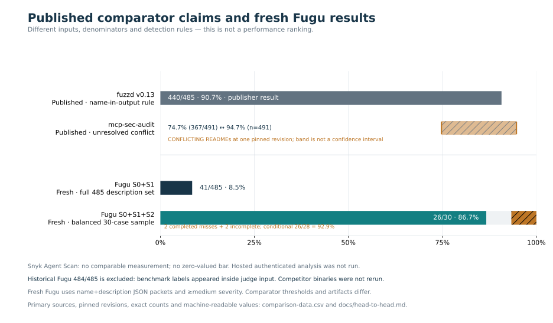

# Fugu and published comparator results

Updated 2026-10-02. **These measurements do not establish a ranking:** inputs,
sample sizes, detection thresholds and execution dates differ. Competitor
binaries were not rerun in this task.



## Fresh Fugu evidence

The frozen S0+S1+S2 run produced **26 detections among 30 selected MCPTox attacks
(86.7% of planned cases)**: 28 analyses completed, including two without a
medium-or-higher finding; two had JSON parse failures. The secondary,
completed-case rate is 26/28 (92.9%). Incomplete cases remain unknown, rather
than being classified as clean.

All 20 constructed clean tool descriptions completed without medium-or-higher
flags. Public skills are a separate cohort: 0/19 completed analyses flagged,
with one incomplete analysis out of 20 planned. These are benign **flag rates**,
not an independently established false-positive rate for the ecosystem.

[Full protocol, failures and usage](benchmark.md) ·
[Per-case live evidence](../bench/results/2026-10-02/semantic.json) ·
[Chart data CSV](benchmark-charts/comparison-data.csv)

## What the primary comparator sources actually report

| Tool / source | Published claim | Protocol and limits |
|---|---|---|
| fuzzd v0.13 benchmark README | 440/485 = 90.72% | MCPTox-derived tool definitions; detection when a tool name appears in scanner output. Reports 0/20 on its own constructed clean tools. |
| mcp-sec-audit detection README | 367/491 = 74.75% | Capability coverage. Also refers to 493 tools in surrounding prose. |
| mcp-sec-audit root README, **same revision** | 94.7%, n=491 | Numerator is not supplied there. Conflicts with the detection README; unresolved. |
| Snyk Agent Scan | No comparable measurement in this task | Current CLI documentation describes authenticated hosted analysis. No token or account was provisioned for this comparison. |

Pinned primary sources:

- [fuzzd benchmark, revision f739e120](https://github.com/ksek87/fuzzd/blob/f739e120cd7dc253fead2a1f13668f9535e4d8a5/bench/README.md)
- [mcp-sec-audit detection README, revision 457057a7](https://github.com/nyit-vancouver/mcp-sec-audit/blob/457057a7dfda6b81622a12ee68b74f76f3fbde85/detection/README.md)
- [mcp-sec-audit root README, same revision](https://github.com/nyit-vancouver/mcp-sec-audit/blob/457057a7dfda6b81622a12ee68b74f76f3fbde85/README.md)
- [Snyk CLI reference, revision 01071238](https://github.com/snyk/agent-scan/blob/010712387e91fe7628cf356aeb83e78b6c6fc035/docs/cli-reference.md)

The delivered source index contains references, hashes and extracted numeric
claims. Full third-party README/CLI/Cargo files and the clean-tool fixture are
excluded from the tracked deliverable inventory. Detector reproduction uses
the explicit [pinned fixture download and hash check](benchmark.md#clean-tool-fixture-prerequisite);
offline chart generation needs only retained result JSON and the source index.

The chart shows both mcp-sec-audit claims as an unresolved band. It is neither
a confidence interval nor a new measurement. Snyk has no numeric bar; missing
measurements are not zero. The Docker daemon was unavailable and Cargo was not
installed, so a safely isolated local fuzzd run was not feasible. No shared
dependencies were installed to force one.

## Why historical Fugu 484/485 is excluded

The retained [historical semantic artifact](../bench/results/mcptox-puretool-semantic.json)
records 484/485 (99.79%), but its adapter placed the attack category, paradigm
and an explicit description of the payload as poisoned inside `server.py`.
It also wrote `case.json` beside that file. The semantic stage excluded benchmark
manifests but did not exclude either of these label-bearing inputs.

Consequently, citing `server.py` does not demonstrate a blind evaluation. The
old result is preserved for traceability and must not support a clean detection
headline or superiority claim. Other legacy runs using the same adapter, including
the retained strict 160-case result, require the same qualification. This task
does not quantify how much those labels changed the judge's answers.

The fresh adapter presents only the original tool name and description. It
does not add schemas, annotations, ground-truth labels, provenance comments or
raw case files. Attack and constructed benign descriptions use the same wrapper.
The public-skills cohort uses extension files and is reported separately.

## Comparability boundaries

- Fugu's fresh static description pass is 41/485 (8.45%); its semantic pass is a
  balanced 30-case sample, not a fresh full-485 result.
- Fugu detects any finding at least medium severity. fuzzd's published
  name-in-output rule and mcp-sec-audit's capability coverage are different
  decisions. Matching a denominator alone does not make them equivalent.
- The 491/493 mcp-sec-audit denominator is not the 485-case Fugu/fuzzd subset.
- MCPTox is an external research attack benchmark, not a random sample of
  malicious extensions found in the wild. These data do not estimate deployment
  prevalence, precision or overall accuracy.
- The earlier few-cents claim was not supported by billing evidence and is
  removed. Fresh API token counts are recorded; monetary cost and remaining
  provider quota are unknown.
- The old suggestion that broad static patterns necessarily explain a
  competitor's ecosystem false-positive rate is unsupported by these runs.

## Reproduce the charts

One-time setup (downloads into an isolated environment; no project dependency changes):

```sh
UV_CACHE_DIR=/tmp/fugu-uv-cache uv venv /tmp/fugu-charts-venv
UV_CACHE_DIR=/tmp/fugu-uv-cache uv pip install \
  --python /tmp/fugu-charts-venv/bin/python matplotlib==3.11.2
```

Then render offline:

```sh
MPLCONFIGDIR=/tmp/fugu-mpl XDG_CACHE_HOME=/tmp/fugu-font-cache \
  /tmp/fugu-charts-venv/bin/python -m bench.benchmark_charts
```

This reads retained JSON and uses no network or model calls. The isolated
plotting environment was provisioned by the lead; project dependency files
were unchanged. See [benchmark.md](benchmark.md) for detector reproduction.
